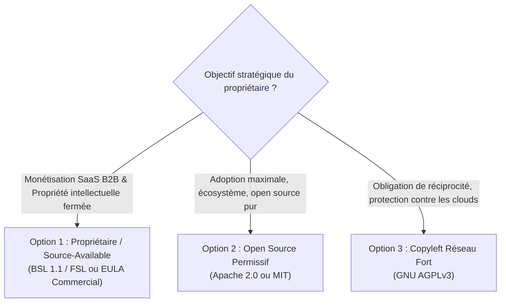

# Matrice de Gouvernance des Données & Licences des Fournisseurs ORBITAL

> [!IMPORTANT]
> **Avertissement de non-responsabilité juridique** : Ce document constitue une analyse technique et architecturale de conformité préparée dans le cadre d'un audit de diligence raisonnable (*due diligence*). Il ne constitue pas un avis juridique formel et ne se substitue pas à une consultation auprès d'un cabinet d'avocats spécialisé en propriété intellectuelle, droit des données et régulation des exportations.

---

## 1. Objectifs & Méthodologie

Ce référentiel recense **36 lignes de périmètre (sources, flux, imports, jeux cartographiques et services)** identifiés dans le code source d'ORBITAL (`src/server/connectors/`, `src/server/feeds/`, `src/server/layers/`, `src/server/aura/`, `public/data/` et `data/layers/`).

### Statut des preuves — révision du 21 octobre 2026

**Inventaire technique vérifié**, non certification juridique exhaustive. Les 36 lignes comprennent un connecteur GKG historique désactivé, un import CSV, un package cartographique et un service IA : ce ne sont pas 36 flux actifs ni 36 fournisseurs distincts. La complétude contractuelle de chaque fournisseur reste à confirmer.

**Vérifié dans le dépôt** : absence de fichier LICENSE à la racine ; package marqué private ; pipeline actif GDELT 2.0 Events avec enrichissement GKG 2.1 ; ancien endpoint GKG v1 désactivé. Les attributions existantes sont conservées.

**Restriction identifiée** : les conditions officielles OpenSky exigent une licence écrite pour les usages commerciaux ; leur page doit être revalidée avant contrat. **À confirmer** : les modalités AISStream ; aucune interdiction générale du SaaS payant n'est établie par la seule gratuité de l'accès. La FAQ TeleGeography renvoie les utilisateurs de données à une demande d'accès : cela ne démontre pas une contrefaçon avérée du dépôt ni une autorisation de redistribution.

**Lecture de la matrice et des fiches** : les classifications et permissions non accompagnées d'une preuve contractuelle versionnée sont des indications préliminaires **à confirmer**, pas des droits acquis. LOW signifie probablement compatible sous réserve de vérification du jeu exact, des attributions et du contrat ; HIGH signale une restriction identifiée ou un risque à traiter, pas une infraction judiciairement établie. L'accès public, la gratuité, BYOK, une donnée dérivée ou un usage personnel ne valent jamais autorisation automatique.

Sources officielles consultées pour cette révision : [GDELT About](https://www.gdeltproject.org/about.html), [OpenSky Terms](https://opensky-network.org/about/terms-of-use), [TeleGeography FAQ](https://www.submarinecablemap.com/faq), [AISStream](https://aisstream.io/). Les liens historiques des fiches ne constituent pas une preuve de vérification de tous leurs termes actuels.

### Niveaux de risque d'exploitation commerciale

| Niveau | Définition opérationnelle |
| :--- | :--- |
| **LOW** | Données du domaine public (ex. Gouvernement fédéral US), licences ouvertes permissives (CC0, OGL, MIT, CC BY avec attribution standard). Probablement compatible ; vérifier la licence exacte, les droits tiers et les obligations avant exploitation. |
| **MEDIUM** | Données libres pour usage informatif mais soumises à des contraintes strictes : attribution académique rigoureuse, interdiction d'allégation d'approbation officielle (UN, OMS, FMI), quotas stricts ou obligation d'un abonnement payant au-delà du palier de développement. |
| **HIGH** | **Incompatibilité juridique directe avec un modèle commercial non négocié** : conditions d'utilisation interdisant expressément l'usage commercial (*Non-Commercial*), données propriétaires fermées sans droit de redistribution (*scraping* d'API privées, bases protégées par le droit *sui generis* du producteur de base de données). |
| **REVUE JURIDIQUE REQUISE** | Zone d'ambiguïté légale : absence de licence explicite sur un endpoint API public, statut flou entre données factuelles non protégeables et droits d'auteur sur la compilation, ou dépendance à des conventions intergouvernementales complexes. |

---

## 2. Matrice Synoptique des 36 Lignes de Périmètre

| Source | Catégorie | Licence / Régime | Stockage local | Usage Commercial | Risque Commercial | Action requise |
| :--- | :--- | :--- | :--- | :--- | :--- | :--- |
| **ACLED** | Conflits | Conditions contractuelles à vérifier | ⚠️ À confirmer | ⚠️ Contrat applicable à confirmer | **HIGH** | Vérifier droits payants et redistribution ; BYOK ne suffit pas. |
| **UCDP (GED)** | Conflits | CC BY 4.0 / ToS API | ✅ Oui | ⚠️ Oui (avec attribution stricte) | **MEDIUM** | Mentionner la citation universitaire formelle UCDP dans l'interface et l'API. |
| **GKG API v1 (historique désactivé)** | Événements / Presse | Open Data (Public) | ✅ Oui | ✅ Oui | **LOW** | Conserver uniquement métadonnées, scores CAMEO et URL sources (pas de texte intégral). |
| **GDELT 2.0 (Events)** | Événements / Presse | Open Data (Public) | ✅ Oui | ✅ Oui | **LOW** | Purge glissante à 30 jours (déjà configurée dans ORBITAL). |
| **Import CSV Opérateur**| Conflits | Données propres client | ✅ Oui | ✅ Oui (responsabilité client) | **LOW** | Clause de non-responsabilité sur la provenance des imports utilisateurs. |
| **NASA FIRMS** | Thermique | US Gov Public Domain | ✅ Oui | ✅ Oui | **LOW** | Mentionner l'attribution NASA FIRMS et conserver l'avertissement « anomalie thermique ». |
| **NASA EONET** | Catastrophes | US Gov Public Domain | ✅ Oui | ✅ Oui | **LOW** | Attribution NASA standard. |
| **Launch Library 2** | Espace | ToS The Space Devs | ⚠️ Cache seul | ⚠️ **Contrat requis** (> gratuit) | **MEDIUM** | Vérifier quotas et usages commerciaux du palier exact ; ne pas présumer les limites actuelles. |
| **USGS Earthquakes** | Séismes | US Gov Public Domain | ✅ Oui | ✅ Oui | **LOW** | Attribution USGS standard. |
| **GDACS** | Catastrophes | Accord UN OCHA / EC JRC | ⚠️ Cache seul | ⚠️ Toléré (données d'alerte) | **LOW-MEDIUM** | Mentionner le statut de donnée préliminaire d'urgence ; vérifier l'absence d'endossement. |
| **NOAA NWS** | Météo US | US Gov Public Domain | ✅ Oui | ✅ Oui | **LOW** | Déclarer un User-Agent conforme à la politique NWS. |
| **NOAA NHC** | Cyclones | US Gov Public Domain | ✅ Oui | ✅ Oui | **LOW** | Attribution NOAA standard. |
| **ECCC (Météo Canada)**| Météo Canada| OGL-Canada v2.0 | ✅ Oui | ✅ Oui | **LOW** | Mentionner l'attribution obligatoire Open Government Licence – Canada. |
| **WMO SWIC** | Météo Monde | Résolution OMM 40/42 | ⚠️ Cache seul | ⚠️ **REVUE JURIDIQUE REQUISE**| **MEDIUM** | Vérifier la redistribution commerciale des alertes nationales membres de l'OMM. |
| **WHO / OMS (DON)** | Épidémies | ToS OMS (Copyright) | ⚠️ Cache seul | ⚠️ Factualité / Non-endossement | **MEDIUM** | Proscrire tout logo OMS ; mentionner le lien direct vers le bulletin officiel. |
| **Yahoo Finance** | Marchés / Finance | Conditions Yahoo et droits des places à vérifier | ⚠️ À confirmer | ⚠️ Revue juridique nécessaire | **HIGH** | Établir les droits de données de marché ou évaluer un fournisseur licencié. |
| **Frankfurter / BCE** | Devises | MIT (API) / Données BCE | ✅ Oui | ✅ Oui | **LOW** | Attribution de la Banque Centrale Européenne comme source des taux de référence. |
| **World Bank API** | Indicateurs | CC BY 4.0 | ✅ Oui | ✅ Oui | **LOW** | Citation World Bank Open Data obligatoire dans la fiche pays. |
| **adsb.lol** | ADS-B Militaire | Données ouvertes partagées | ⚠️ Cache seul | ⚠️ Communautaire (Fair use) | **MEDIUM-HIGH** | Ne pas saturer l'infrastructure bénévole ; prévoir fallback ou instance feeder privée. |
| **adsb.fi** | ADS-B Militaire | Données ouvertes partagées | ⚠️ Cache seul | ⚠️ Communautaire (Fair use) | **MEDIUM-HIGH** | Contacter les opérateurs pour accord d'usage commercial ou sponsoriser l'infrastructure. |
| **OpenSky Network** | Espace aérien | ToS OpenSky (Non-commercial)| ⚠️ Cache seul | ❌ **INTERDIT** sans licence | **HIGH** | Négocier un accord commercial OpenSky ou remplacer par un feed ADS-B agréé. |
| **AISStream.io** | AIS Maritime | Conditions à confirmer | ⚠️ À confirmer | ⚠️ Revue juridique nécessaire | **REVUE JURIDIQUE REQUISE** | Obtenir les conditions écrites pour stockage, usage payant et redistribution ; BYOK ne les remplace pas. |
| **ITU MID** | Pavillons mer | Données publiques UIT | ✅ Oui | ✅ Oui | **LOW** | Table de référence technique factuelle non protégeable. |
| **World Nuclear News** | Nucléaire | RSS Syndication ToS | ⚠️ Cache seul | ⚠️ Liens & titres seuls | **LOW-MEDIUM** | Ne redistribuer que titre + résumé court + lien URL canonique, pas de texte intégral. |
| **GEIPAN (CNES)** | UAP / Aérospatial| Licence Ouverte v2.0 | ✅ Oui | ✅ Oui | **LOW** | Mentionner la paternité CNES/GEIPAN. |
| **AARO (US DoD)** | UAP / Aérospatial| US Gov Public Domain | ⚠️ Non (403) | ✅ Oui (si accessible) | **LOW** | Respecter l'interdiction de contournement de la protection HTTP 403. |
| **UN News / ONU Info** | Diplomatie | UN Conditions of Use (RSS) | ⚠️ Cache seul | ⚠️ Syndication de titres | **LOW** | Titres et liens canoniques uniquement ; pas d'association officielle UN. |
| **UN Press Releases** | Diplomatie | UN Conditions of Use (RSS) | ⚠️ Cache seul | ⚠️ Syndication de titres | **LOW** | Titres et liens canoniques uniquement. |
| **OFAC SDN List** | Sanctions | US Gov Public Domain | ✅ Oui | ✅ Oui | **LOW** | Insérer une clause impérative de non-responsabilité juridique financière. |
| **TeleGeography** | Câbles sous-marins | Droits PriMetrica à examiner | ⚠️ Permission à confirmer | ⚠️ Revue juridique nécessaire | **HIGH** | Vérifier provenance et licence ; conserver attribution ; aucune suppression dans cet audit. |
| **IODA** | Pannes Internet | Recherche Georgia Tech | ⚠️ Cache seul | ⚠️ **REVUE JURIDIQUE REQUISE**| **MEDIUM-HIGH** | Demander une autorisation de réutilisation commerciale à Georgia Tech Research Corp. |
| **IMF PortWatch** | Ports mondiaux | ToS FMI / Oxford | ⚠️ Cache seul | ⚠️ Usage informatif seul | **MEDIUM** | Demander confirmation écrite au FMI pour inclusion dans un tableau de bord payant. |
| **Natural Earth** | Cartographie | **Domaine Public** | ✅ Oui | ✅ Oui | **LOW** | Aucune restriction. Attribution de bonne pratique recommandée. |
| **world-atlas (npm)** | Cartographie | **Licence ISC** | ✅ Oui | ✅ Oui | **LOW** | Licence permissive intégrée. |
| **Wikidata SPARQL** | Entités / Bases | **CC0 1.0 (Public Domain)** | ✅ Oui | ✅ Oui | **LOW** | Données CC0 sans restriction. Respecter les règles de politesse SPARQL (User-Agent). |
| **OpenAI (AURA)** | Analyse IA / TTS | OpenAI Business Terms | ✅ Oui | ✅ Oui | **LOW-MEDIUM** | Se conformer à l'obligation de transparence de l'IA (EU AI Act : mentionner la nature générée). |

---

## 3. Fiches d'Audit Détaillées des Fournisseurs

### 3.1. Conflits Armés & Sécurité Internationale

#### ACLED (Armed Conflict Location & Event Data Project)
- **Identifiant interne** : `acled` (`src/server/connectors/acled.ts`)
- **URL officielle** : [acleddata.com](https://acleddata.com) — [Conditions d'utilisation ACLED](https://acleddata.com/terms-of-use/)
- **Type de données** : Enregistrements géolocalisés de conflits armés, manifestations, acteurs et bilans humains.
- **Régime de licence** : Conditions ACLED et contrat du compte à confirmer, selon le jeu et la formule d'accès.
- **Usage commercial** : Revue juridique nécessaire du contrat et des droits de redistribution ; aucune infraction n'est établie ici sans cet examen.
- **Stockage local** : Durées et droits de constitution d'une base miroir à confirmer par contrat.
- **Niveau de risque** : **HIGH** (Bloquant majeur pour toute commercialisation B2B).
- **Plan de remédiation** :
  1. Maintenir ACLED désactivé par défaut (`ACLED_DISABLED=1`).
  2. Proposer un mode *Bring Your Own Key* (BYOK) où le client souscrit directement sa propre licence commerciale auprès d'ACLED et injecte ses identifiants.
  3. Alternative Open Data : UCDP GED Candidate.

#### UCDP (Uppsala Conflict Data Program)
- **Identifiant interne** : `ucdp` (`src/server/connectors/ucdp.ts`)
- **URL officielle** : [ucdp.uu.se](https://ucdp.uu.se) — [Documentation API UCDP](https://ucdp.uu.se/downloads/apidocumentation/)
- **Type de données** : Données géoréférencées d'événements de violence organisée (GED Candidate mensuel).
- **Régime de licence** : Creative Commons Attribution 4.0 International (**CC BY 4.0**).
- **Attribution légale requise** :
  > « Davies, Shawn, Therese Pettersson & Magnus Öberg (2024). Organized violence 1989-2023, and the challenges to civilian protection. Journal of Peace Research 61(4). »
- **Usage commercial** : Autorisé sous CC BY 4.0, sous réserve de mentionner explicitement la paternité, de fournir un lien vers la licence et d'indiquer si des modifications ont été apportées.
- **Stockage local** : Autorisé.
- **Niveau de risque** : **MEDIUM** (Risque juridique faible si l'attribution académique complète est intégrée dans l'UI et les payloads d'API).

#### GDELT Project : Events 2.0 + GKG 2.1, GKG API v1 historique
- **Identifiant interne** : `gdelt` (`src/server/connectors/gdelt.ts`, `gdeltEvents.ts`, `src/server/feeds/social.ts`)
- **URL officielle** : [gdeltproject.org](https://www.gdeltproject.org)
- **État technique vérifié** : `gdeltEvents.ts` lit les archives Events 2.0 (`gdeltv2/*.export.CSV.zip`) et enrichit les titres via GKG 2.1 (`*.gkg.csv.zip`). `gdelt.ts` appelle un endpoint API v1 GKG historique mais est désactivé et absent du registre actif. Ne pas confondre version d'endpoint et génération des données.
- **Type de données** : Détection d'événements mondiaux par traitement du langage naturel sur les dépêches de presse mondiales (codage CAMEO, tonalité, mentions d'acteurs).
- **Régime de licence** : GDELT déclare sa base librement et ouvertement disponible ; qualification de domaine public et droits sur les contenus tiers à confirmer.
- **Usage commercial** : Probablement compatible pour les métadonnées GDELT ; vérifier les conditions applicables et les droits des éditeurs liés avant redistribution.
- **Restriction spécifique** : GDELT fournit des métadonnées et des liens vers des articles tiers. ORBITAL ne doit jamais indexer ni redistribuer le texte intégral protégé des éditeurs de presse afin de respecter le droit d'auteur des agences (AFP, Reuters, AP).
- **Stockage local** : Rétention glissante de 30 jours configurée (`ORBITAL_RETENTION_GDELT_DAYS=30`).
- **Niveau de risque** : **LOW**.

---

### 3.2. Surveillance Thermique & Satellites

#### NASA FIRMS (Fire Information for Resource Management System)
- **Identifiant interne** : `firms` (`src/server/connectors/firms.ts`)
- **URL officielle** : [firms.modaps.eosdis.nasa.gov](https://firms.modaps.eosdis.nasa.gov) — [Politique de données NASA Earth Science](https://www.earthdata.nasa.gov/engage/open-data-services-and-software/data-and-information-policy)
- **Type de données** : Détections thermiques satellitaires (capteurs MODIS et VIIRS).
- **Régime de licence** : Domaine public fédéral américain (*US Government Work*). Accès libre, ouvert et sans restriction, y compris commerciale.
- **Attribution légale requise** :
  > « We acknowledge the use of data and/or imagery from NASA's Fire Information for Resource Management System (FIRMS) (https://earthdata.nasa.gov/firms), part of the NASA Earth Observing System Data and Information System (EOSDIS). »
- **Clé API** : `FIRMS_MAP_KEY` (gratuite, délivrée instantanément par la NASA pour réguler le trafic).
- **Précaution analytique** : Conserver obligatoirement l'avertissement d'ORBITAL (*« Détection thermique ; aucune attribution à un conflit »*) pour éviter toute responsabilité sur de fausses imputations militaires d'incendies agricoles ou industriels.
- **Niveau de risque** : **LOW**.

---

### 3.3. Marchés Financiers & Données Économiques

#### Yahoo Finance (Endpoint non officiel)
- **Identifiant interne** : `economy` (`src/server/feeds/economy.ts`)
- **URL endpoint** : `https://query1.finance.yahoo.com/v8/finance/chart/`
- **Régime de licence** : **Conditions générales d'utilisation Yahoo / Apollo Global Management**.
- **Analyse critique** :
  - L'endpoint `query1.finance.yahoo.com` est une interface privée interne non documentée, sans contrat d'API public.
  - Vérifier les clauses Yahoo applicables à l'automatisation et la rediffusion ainsi que les permissions effectivement obtenues.
  - Les droits des places de marché peuvent imposer des conditions et redevances distinctes ; contrat et produit à examiner.
- **Niveau de risque** : **HIGH** (Risque d'action en contrefaçon et de blocage unilatéral par adresse IP).
- **Plan de remédiation** :
  - **Option 1 (Open Data / Gratuit)** : Se limiter aux taux de change officiels de la Banque Centrale Européenne (Frankfurter API) et aux matières premières publiées par des organismes publics (World Bank Commodity Price Data / FRED de la Réserve Fédérale de St. Louis).
  - **Option 2 (Commercial)** : Souscrire une licence commerciale de données financières auprès d'un courtier d'API légal (Finnhub, Alpha Vantage, Polygon.io ou Bloomberg Enterprise).

#### Frankfurter API / Banque Centrale Européenne (ECB)
- **Identifiant interne** : `economy` (`src/server/feeds/economy.ts`)
- **URL officielle** : [frankfurter.dev](https://frankfurter.dev) — [BCE Taux de change de référence](https://www.ecb.europa.eu/stats/policy_and_exchange_rates/euro_reference_exchange_rates/html/index.en.html)
- **Type de données** : Taux de change de référence de l'Euro face aux principales devises.
- **Régime de licence** : Code de l'API sous licence MIT. Données amont issues de la Banque Centrale Européenne, réutilisables gratuitement à des fins commerciales et non-commerciales avec mention de la source.
- **Niveau de risque** : **LOW**.

#### Banque Mondiale (World Bank Open Data API)
- **Identifiant interne** : `countryIndicators` (`src/server/countryIndicators.ts`)
- **URL officielle** : [data.worldbank.org](https://data.worldbank.org) — [World Bank Terms of Use](https://www.worldbank.org/en/about/legal/terms-of-use-for-datasets)
- **Type de données** : Indicateurs macro-économiques et démographiques annuels (PIB nominal, population totale).
- **Régime de licence** : Creative Commons Attribution 4.0 (**CC BY 4.0**).
- **Attribution requise** : « Données de la Banque mondiale ».
- **Niveau de risque** : **LOW**.

---

### 3.4. Données Maritimes & Aériennes en Temps Réel

#### AISStream.io
- **Identifiant interne** : `maritime` (`src/server/feeds/maritime.ts`)
- **URL officielle** : [aisstream.io](https://aisstream.io) — [AISStream Terms](https://aisstream.io/terms)
- **Type de données** : Flux WebSocket mondial de trames AIS décodées (positions de navires civils et militaires).
- **Régime de licence** :
  - Accès gratuit annoncé ; périmètre contractuel commercial et redistribution **à confirmer** auprès de l'opérateur.
  - L'interdiction générale de tout SaaS payant n'a pas été démontrée ; ne pas la présenter comme un fait vérifié.
- **Niveau de risque** : **REVUE JURIDIQUE REQUISE** (conditions de commercialisation non établies).
- **Plan de remédiation** : Contacter AISStream pour un contrat revendeur/commercial, ou migrer vers un fournisseur maritime d'entreprise (Spire Maritime, VesselFinder API, MarineTraffic Enterprise).

#### adsb.lol & adsb.fi
- **Identifiant interne** : `military` (`src/server/feeds/military.ts`)
- **URL officielle** : [adsb.lol](https://adsb.lol) et [adsb.fi](https://adsb.fi)
- **Type de données** : Données de vol non filtrées issues de réseaux coopératifs de récepteurs SDR bénévoles (filtrage militaire sur `/v2/mil`).
- **Régime de licence** : Open Data communautaire sans garantie de service.
- **Contrainte opérationnelle** : Quotas et permissions de chaque réseau à confirmer ; un fallback ne doit jamais être présenté comme un droit de contourner les limites.
- **Niveau de risque** : **MEDIUM-HIGH** (viabilité et légitimité éthique/commerciale).
- **Plan de remédiation** : Mettre en place un sponsoring formel de l'infrastructure open source adsb.fi/adsb.lol, ou déployer son propre réseau de collecte/antennes pour les clients souverains.

#### OpenSky Network
- **Identifiant interne** : `airspace` (`src/server/airspace.ts`)
- **URL officielle** : [opensky-network.org](https://opensky-network.org) — [OpenSky Terms of Use](https://opensky-network.org/about/terms-of-use)
- **Type de données** : Vecteurs d'état du trafic aérien mondial (altitude, vitesse, indicatif, indicatifs OACI).
- **Régime de licence** : Association académique suisse à but non lucratif. Données réservées à l'enseignement, à la recherche académique et à l'usage personnel.
- **Usage commercial** : **STRICTEMENT INTERDIT** sans accord de licence commerciale formel.
- **Niveau de risque** : **HIGH** (en exploitation SaaS commerciale).
- **Plan de remédiation** : Utiliser OpenSky uniquement comme connecteur activable en environnement de recherche ; désactiver pour les offres commerciales B2B au profit d'un flux commercial (FlightAware Firehose / Cirium).

---

### 3.5. Câbles Sous-marins & Infrastructures Critiques

#### TeleGeography Submarine Cable Map
- **Identifiant interne** : `cables` (`src/server/layers/cables.ts` et `data/layers/submarine_cables.json`)
- **URL officielle** : [submarinecablemap.com](https://www.submarinecablemap.com) — [Mentions légales TeleGeography / PriMetrica](https://www.telegeography.com/terms-of-use/)
- **Type de données** : Tracés vectoriels géo-référencés et stations d'atterrissement des câbles de télécommunication sous-marins mondiaux.
- **Régime de licence** : **PROPRIÉTÉ EXCLUSIVE DE PRIMETRICA, INC.**
  - Citation contractuelle de l'audit initial non authentifiée : ne pas l'utiliser comme preuve ; consulter les conditions effectives et la FAQ du fournisseur.
- **Analyse de risque — droits à confirmer** :
  - Le dépôt contient `data/layers/submarine_cables.json` ; vérifier sa provenance, les conditions de collecte et les permissions obtenues par le détenteur.
  - La redistribution commerciale nécessite de vérifier les droits applicables ; l'infraction n'est pas démontrée par la seule présence du fichier.
- **Niveau de risque** : **HIGH** (revue juridique nécessaire avant diffusion commerciale sans preuve de permission).
- **Plan de remédiation impératif** :
  1. Vérifier ou obtenir les permissions pour `data/layers/submarine_cables.json` avant distribution ; en leur absence, évaluer désactivation ou alternative avec les ayants droit.
  2. Alternative Open Data : Utiliser les tracés de câbles sous-marins issus du projet **OpenStreetMap** (tag `telecom=cable` / `man_made=pipeline`) sous licence **ODbL** (requiert attribution OSM).

#### IODA (Internet Outage Detection and Analysis)
- **Identifiant interne** : `infrastructure` (`src/server/feeds/infrastructure.ts`)
- **URL officielle** : [ioda.inetintel.cc.gatech.edu](https://ioda.inetintel.cc.gatech.edu/)
- **Type de données** : Alertes de pannes et coupures massives d'accès à Internet par pays et système autonome (BGP, darknet télescopique, sondes actives).
- **Régime de licence** : Données de recherche produites par le Georgia Institute of Technology (Center for Applied Internet Data Analysis - CAIDA / Gatech).
- **Niveau de risque** : **MEDIUM-HIGH** (REVUE JURIDIQUE REQUISE pour utilisation commerciale).

#### IMF PortWatch (Fonds Monétaire International)
- **Identifiant interne** : `infrastructure` (`src/server/feeds/infrastructure.ts`)
- **URL officielle** : [portwatch.imf.org](https://portwatch.imf.org)
- **Type de données** : Perturbations et anomalies de flux dans les grands goulots maritimes (Canal de Suez, Bab-el-Mandeb, Canal de Panama).
- **Régime de licence** : FMI / Université d'Oxford. Réutilisation autorisée à des fins d'information et d'analyse générale.
- **Niveau de risque** : **MEDIUM** (Vérifier les clauses de non-responsabilité financière sur les décisions de routage logistique).

---

### 3.6. Catastrophes Naturelles & Météorologie

#### GDACS (Global Disaster Alert and Coordination System)
- **Identifiant interne** : `disaster` (`src/server/feeds/disaster.ts`)
- **URL officielle** : [gdacs.org](https://www.gdacs.org)
- **Partenaires** : Nations Unies (OCHA) et Commission Européenne (JRC - Joint Research Centre).
- **Régime de licence** : Données publiques internationales d'urgence humanitaire. Réutilisation libre avec attribution.
- **Niveau de risque** : **LOW-MEDIUM**.

#### USGS (US Geological Survey)
- **Identifiant interne** : `disaster` (`src/server/feeds/disaster.ts`)
- **URL officielle** : [earthquake.usgs.gov](https://earthquake.usgs.gov)
- **Régime de licence** : Domaine public fédéral américain (*US Government Work*).
- **Niveau de risque** : **LOW**.

#### NOAA (National Weather Service & National Hurricane Center)
- **Identifiant interne** : `weather` (`src/server/feeds/weather.ts`)
- **URL officielle** : [weather.gov](https://www.weather.gov) / [nhc.noaa.gov](https://www.nhc.noaa.gov)
- **Régime de licence** : Domaine public fédéral américain (*US Government Work*).
- **Niveau de risque** : **LOW**.

#### ECCC (Environnement et Changement Climatique Canada)
- **Identifiant interne** : `weather` (`src/server/feeds/weather.ts`)
- **URL officielle** : [weather.gc.ca](https://weather.gc.ca)
- **Régime de licence** : Open Government Licence – Canada (OGL-Canada v2.0).
- **Attribution obligatoire** : « Contient de l'information sous licence du gouvernement du Canada ».
- **Niveau de risque** : **LOW**.

#### OMM / WMO (World Meteorological Organization - SWIC)
- **Identifiant interne** : `weather` (`src/server/feeds/weather.ts`)
- **URL officielle** : [severeweather.wmo.int](https://severeweather.wmo.int)
- **Régime de licence** : Agence spécialisée de l'ONU. Les conditions dépendent des services météorologiques nationaux contributeurs.
- **Niveau de risque** : **MEDIUM** (REVUE JURIDIQUE REQUISE).

---

### 3.7. Sanctions Financières & Réglementaires

#### OFAC (Office of Foreign Assets Control - US Department of the Treasury)
- **Identifiant interne** : `sanctions` (`src/server/layers/sanctions.ts` et `data/layers/sanctions.json`)
- **URL officielle** : [treasury.gov/ofac](https://www.treasury.gov/ofac)
- **Type de données** : Liste des personnes et entités spécialement désignées (*Specially Designated Nationals - SDN List*).
- **Régime de licence** : Domaine public fédéral américain.
- **Responsabilité juridique civile et pénale** :
  - **Avertissement crucial** : La liste OFAC est mise à jour de manière continue. Si un client professionnel fonde une décision de conformité financière (KYC/AML) sur une version en cache d'ORBITAL non rafraîchie, la responsabilité civile d'ORBITAL pourrait être recherchée en l'absence de clause d'exclusion claire.
- **Niveau de risque** : **LOW sur la propriété intellectuelle**, mais **HIGH sur la responsabilité d'usage**.
- **Action requise** : Insérer un disclaimer contractuel strict : *« Données OFAC fournies à titre strictement indicatif et géopolitique ; ne constitue pas un instrument officiel de contrôle de conformité bancaire ou financière. »*

---

### 3.8. Données Cartographiques, Villes & Wikidata

#### Natural Earth Data & world-atlas
- **Emplacements** : `public/data/ne_110m_countries.geojson`, `public/data/ne_110m_places.geojson`, `public/world-110m.json`
- **URL officielle** : [naturalearthdata.com](https://www.naturalearthdata.com)
- **Régime de licence** : Domaine public annoncé ; probablement compatible, sous réserve de vérifier le jeu exact et les contenus tiers.
- **Niveau de risque** : **LOW**.

#### Wikidata Query Service (SPARQL)
- **Emplacements** : `src/server/layers/wikidata.ts`, `src/server/leaders.ts`, `data/layers/military_bases.json`, `data/layers/nuclear_plants.json`
- **URL officielle** : [wikidata.org](https://www.wikidata.org)
- **Régime de licence** : **Creative Commons CC0 1.0 Universal (Public Domain Dedication)**.
- **Usage commercial** : Probablement compatible pour les données CC0 ; vérifier les conditions du service et les contenus tiers. Attribution conservée comme bonne pratique.
- **Règle technique** : Obligation de déclarer un `User-Agent` distinctif avec contact pour respecter la charte de politesse Wikimedia.
- **Niveau de risque** : **LOW**.

---

### 3.9. IA Générative & Analyse Vocale

#### OpenAI API (Moteur AURA & Synthèse Vocale TTS)
- **Configuration** : `src/server/aura/`, `src/server/voice.ts` (`OPENAI_API_KEY`)
- **Régime juridique** : OpenAI Business Terms of Service.
- **Propriété des données** : Le client détient les droits d'entrée et de sortie (*Customer Content*). OpenAI n'entraîne pas ses modèles sur les flux API professionnels.
- **Conformité réglementaire** :
  - **Règlement européen sur l'IA (EU AI Act)** : Revue juridique nécessaire du champ et des obligations applicables ; la signature AURA seule ne démontre pas la conformité.
  - Synthèse vocale : Ne pas imiter la voix d'une personnalité réelle sans consentement.
- **Niveau de risque** : **LOW-MEDIUM** (Coût variable dépendant de la consommation, conformité d'étiquetage IA).

---

## 4. Audit des Bibliothèques Logicielles Tierces (NPM)

Relevé indicatif de dépendances directes, pas audit complet de licences transitives ni SBOM. Les versions et régimes ci-dessous doivent être rapprochés du lockfile et des fichiers de licence des artefacts réellement distribués. **Aucune absence globale de GPL/AGPL n'est démontrée** ; un audit de vulnérabilités ne constitue pas un audit de licences.

| Dépendance | Version | Licence officielle | Risque commercial |
| :--- | :--- | :--- | :--- |
| `next` | 15.5.28 | **MIT** | **LOW** |
| `react` / `react-dom` | 19.3.1 | **MIT** | **LOW** |
| `three` | 0.174.0 | **MIT** | **LOW** |
| `pg` | 8.23.1 | **MIT** | **LOW** |
| `zustand` | 5.0.15 | **MIT** | **LOW** |
| `lucide-react` | 0.475.0 | **ISC** | **LOW** |
| `topojson-client` | 3.1.0 | **ISC** | **LOW** |
| `world-atlas` | 2.0.2 | **ISC** | **LOW** |
| `clsx` | 2.1.1 | **MIT** | **LOW** |
| `tailwind-merge` | 3.7.0 | **MIT** | **LOW** |

> [!NOTE]
> À confirmer : licences transitives, binaires, polices, données et obligations NOTICE/attribution. Aucune conclusion générale sur le copyleft n'est possible à partir de cette seule liste.

---

## 5. Stratégie de Licence pour le Dépôt ORBITAL

Vérifié dans cette branche : aucun fichier `LICENSE` à la racine ; `"private": true` dans `package.json`. Ce marqueur empêche la publication npm accidentelle : il ne définit ni licence juridique ni confidentialité GitHub. Aucun choix de licence n'est appliqué par cet audit.

Avant toute ouverture, distribution ou commercialisation, trois options stratégiques s'offrent au propriétaire du projet :

### Options à examiner, sans choix appliqué

- **Propriétaire / Source-Available (BSL, FSL, EULA)** : droits, restrictions, éventuelle conversion et obligations à définir avec les ayants droit ; aucune protection totale contre la concurrence n'est garantie.
- **Permissive (MIT / Apache 2.0)** : probablement compatible avec une distribution commerciale sous réserve des conditions, attributions, notices et éventuels droits de brevets ; ne dispense pas des licences des données.
- **AGPLv3** : obligations de fourniture de source à examiner selon modifications, interaction réseau et périmètre de l'œuvre ; pas une affirmation de contamination automatique des modules voisins.

Une revue juridique est nécessaire avant décision. Aucune licence n'est ajoutée par l'intégration.
