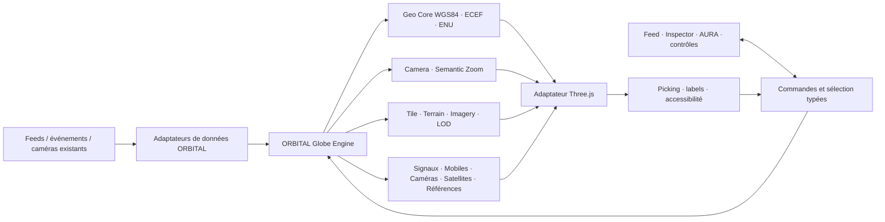

# Globe 2.0 — ORBITAL Globe Engine, Phase 0

**Statut : architecture proposée, sans implémentation.** Base auditée : `origin/main` à `465747d4d2d44a8c12cbfa94fec8718b1dc5a1e1` (PR #11 fusionnée). Three.js reste le moteur graphique de production. Le POC Cesium de la PR #12 est une expérience historique non destinée à être fusionnée. Aucun chiffre de performance ci-dessous n'est une mesure du futur moteur : les budgets sont des **cibles à valider** sur appareils réels.

## 1. État réel du globe et invariants

| Sujet | Constat vérifié dans le code de `main` | Limite / contrat à préserver |
|---|---|---|
| Composition et React | `src/app/page.tsx` charge `IntelApp` côté client ; `src/components/IntelApp.tsx:24` charge `GlobeScene` dynamiquement sans SSR. `src/components/globe/GlobeScene.tsx:85-188` crée `THREE.Scene`, caméra perspective, `WebGLRenderer`, groupe globe et couches. | React gère panneaux et état, Three.js le canevas ; éviter un objet React par marqueur. |
| Géométrie et coordonnées | `src/lib/config/visual.ts` fixe `GLOBE.radius = 1`, `CAMERA.near = 0.01`, `far = 120`, zoom orbital `1.8..8`. `src/lib/geo/latlon.ts:17-45` projette les lat/lon sur une **sphère** alignée sur l'UV équirectangulaire, et `greatCircleKm` est une approximation sphérique. | Pas de WGS84, ECEF, altitude géodésique, terrain ni proximité du sol. Ne pas réinterpréter `radius=1` comme des mètres. |
| Caméra et gestes | `src/components/globe/GlobeCamera.ts` porte rotation, inertie, molette, pinch, focus court chemin, rotation automatique et mouvement réduit ; `GlobeScene.tsx:230-390` branche les pointer events, capture, seuil de tap 5 px et raycast sphérique. `src/lib/globeQuality.ts` ajuste FOV portrait et gestes. | Caméra toujours tournée vers l'origine ; pas d'oblique, pan sol, suivi ou altitude physique. `focus` garde le zoom courant. |
| Terre et style | `HolographicEarth.ts` dessine corps/halo/graticule/continents/frontières/lumières ; `Starfield.ts` et `OrbitLayer.ts` ajoutent l'environnement. `src/lib/config/visual.ts` centralise noir/cyan et rouge des conflits. `src/lib/geo/referentials.ts` charge Natural Earth et met en cache ses Promises. | L'identité ORBITAL, les frontières et les signaux rouges sont des références de non-régression. Aucune imagerie urbaine actuellement. |
| Événements et conflits | `src/components/conflicts/ConflictLayer.ts:24-289` regroupe quads, chaleur et particules en trois objets GPU et fait son picking ; `src/lib/clustering/cluster.ts` calcule cellules et intensité ; `GlobeScene.tsx:498-515` omet les géolocalisations pays/région des **points précis**. | Les foyers rouges doivent rester visibles à l'échelle planète ; une précision pays/région ne peut devenir un point local inventé. |
| Feed | `WorldFeedPanel.tsx` présente le fil, `FeedItem.tsx:146-160` appelle `selectFeedItem`, puis `useIntelStore.ts:428-432` sélectionne et demande un focus si la position existe ; `GlobeScene.tsx:609-611` applique le focus. `FeedLayer.ts` dessine les points non militaires. | Feed, provenance, heure, fraîcheur, caveats et fiche restent des fonctions produit, pas des décorations du globe. Le recentrage n'existe que pour les items géolocalisés. |
| Mobiles | `MobileLayer.ts` utilise un `THREE.Points` et un `LineSegments` : silhouettes d'avion, navire militaire et cargo, cap, taille écran, occlusion et trajets observés. `vehicleModel.ts` distingue cap source/dérivé et ne prolonge pas la trajectoire. `IntelApp.tsx` rafraîchit les catégories mobiles toutes les 15 s. | Même de loin, les mobiles restent reconnaissables ; ni carré ni cellule générique. Ne pas présenter un glissement visuel comme une nouvelle observation. |
| Caméras | `CameraLayer.ts` est un seul `THREE.Points`, avec réduction par cellules et types de média. `useIntelStore.ts:379-420` charge encore jusqu'à 10 000 métadonnées globales par pages, **sur activation seulement** (`camerasOn: false`). `/api/cameras` accepte bbox, filtres et pagination ; `CameraMarker` exclut les URL média/API (`src/types/cameras.ts`). | Le chargement global client est provisoire. Aucun JPEG/HLS avant sélection ; conserver live vidéo / near-live / snapshot et les droits fournisseurs. |
| Satellites | `OrbitLayer.ts:46-135` et `ORBITS.satellites` dans `visual.ts` dessinent **quatre micro-satellites décoratifs** et anneaux animés. | Ce n'est ni un catalogue satellite ni une propagation TLE. Ne jamais l'annoncer comme une position réelle. |
| Pays, références et picking | `world.ts:123-249` construit un index Natural Earth et teste le polygone après bbox. `GlobeScene.tsx:190-359` arbitre conflits → feed/mobile → caméras → référentiels → pays ; `ReferenceLayers.ts` couvre installations, bases, câbles et sanctions. | La priorité de sélection doit devenir déclarative sans perdre les cas existants ni l'identité pays. |
| Zustand, panneaux, AURA | `useIntelStore.ts` détient filtres, clusters, feeds, caméras, sélections et `focusRequest`; `Inspector.tsx` choisit la fiche. `IntelApp.tsx` relie panneau, thème, SSE, mobile et AURA ; `AgentPanel.tsx` et `AuraCore.tsx` portent l'identité actuelle d'AURA. | Sélection unique actuelle ; futurs liens d'investigation peuvent être multiples sans transformer AURA en chat générique. |
| Cycle de vie et mobile | `GlobeScene.tsx:391-490` gère resize, visibilité, RAF, listeners et `dispose` des couches/renderer. `globeQuality.ts` vise 60/30/20 FPS, plafonne DPR à 2/1 et les marqueurs à 350 en mode économique ; `IntelApp.tsx` et `MobileSheet.tsx` gèrent le viewport mobile. | Ces valeurs sont des profils de qualité, **pas des FPS mesurés**. `OrbitLayer.dispose()` ne libère explicitement que ses deux matériaux, pas ses géométries ni les matériaux des micro-satellites : dette de cleanup à vérifier avant réutilisation. Vérifier context loss, réouverture et fuite GPU. |
| Tests | `tests/globe-camera.test.ts`, `tests/globe-quality.test.ts`, `tests/camera-layer.test.ts`, `tests/e2e/scenarios.spec.ts`, `tests/e2e/coverage.spec.ts`, `tests/mobile/navigation.spec.ts` couvrent des éléments de caméra/gestes, marqueurs, parcours et mobile. | Pas de batterie WGS84/terrain/floating origin/LOD/benchmark matériel sur `main`. Conserver tous les tests actuels. |

La CSP actuelle est définie dans `next.config.mjs` et `src/middleware.ts`. Le moteur cible ne doit pas hériter des exceptions `eval`, workers ou réseau du laboratoire Cesium. Les données d'événement restent servies par les API actuelles ; la Phase 0 n'en change aucun contrat.

### Priorité de non-régression

**BLOQUANT** : perte du feed, d'AURA ou de ses formes, des signaux rouges, de la sélection/pays, des silhouettes mobiles, de la provenance, des données existantes, ou erreur de localisation. **IMPORTANT** : navigation, affichage ou performance sensiblement dégradés. **POLISH** : nuances de style/animation. Chaque phase doit comparer visuellement planète, pays, ville/quartier, desktop et mobile ; build et tests verts seuls ne suffisent pas.

## 2. Frontières et flux du moteur



Le **modèle géospatial** (géodésie, caméra, visibilité, tuiles, LOD, sélection) est interne à ORBITAL et testable sans WebGL. Three.js fournit scène, buffers, shaders et GPU. Next.js héberge données, cache, quotas et autorisations. React/Zustand restent l'interface produit : un seul adaptateur publie des *snapshots* de caméra/selection à fréquence bornée ; la boucle RAF ne déclenche pas un `setState` React à chaque image.

Contrats internes proposés (non implémentés) :

```ts
type SourceGeoPoint = Readonly<{ latDeg: number; lonDeg: number; heightM: number | null;
  verticalDatum: 'WGS84_ELLIPSOID' | 'MSL' | 'AGL' | 'UNKNOWN' }>;
type GeoPoint = Readonly<{ latDeg: number; lonDeg: number; heightM: number; datum: 'WGS84' }>;
type GeoResolution =
  | Readonly<{ status: 'resolved'; point: GeoPoint;
      method: 'source-ellipsoid' | 'verified-geoid' | 'verified-terrain'; provenance: string }>
  | Readonly<{ status: 'unresolved'; reason: 'missing-height' | 'unknown-datum' | 'missing-model' | 'invalid-position' }>;
type ResolveSourcePosition = (source: SourceGeoPoint) => GeoResolution;
type EcefMeters = Readonly<{ x: number; y: number; z: number }>;
type RenderVector = Readonly<{ x: number; y: number; z: number; originEpoch: number }>;
type ViewState = Readonly<{ eye: GeoPoint; target: GeoPoint | null; headingRad: number; pitchRad: number;
  rollRad: number; verticalFovRad: number; viewportCss: { width: number; height: number }; mode: 'orbit' | 'surface' | 'track' }>;
type ViewFootprint = Readonly<{ spans: Array<{ west: number; south: number; east: number; north: number }>;
  center: GeoPoint | null; groundSpanM: number | null; horizonVisible: boolean; revision: number }>;
type SelectionKey = Readonly<{ kind: 'event' | 'feed' | 'country' | 'mobile' | 'camera' | 'satellite' | 'reference'; id: string }>;
type MapAnchor = Readonly<{ latDeg: number; lonDeg: number }>;
type GlobeTarget =
  | Readonly<{ kind: 'object'; key: SelectionKey }>
  | Readonly<{ kind: 'map-point'; id: string; position: MapAnchor }>
  | Readonly<{ kind: 'area'; id: string; bounds: ViewFootprint['spans'] }>;
type GlobeLayerId = 'conflicts' | 'feed' | 'aircraft' | 'vessels' | 'cameras' | 'satellites'
  | 'weather' | 'nuclear_plants' | 'military_bases' | 'submarine_cables' | 'sanctions';
type CommandBase<Action extends string> = Readonly<{ id: string;
  source: 'user' | 'feed' | 'aura' | 'timeline'; action: Action; issuedAt: string }>;
type FlyToCommand = CommandBase<'flyTo'> & Readonly<{ payload: {
  target: GlobeTarget; framing: 'center' | 'fit'; durationMs?: number } }>;
type FocusCommand = CommandBase<'focus'> & Readonly<{ payload: { target: GlobeTarget } }>;
type TrackCommand = CommandBase<'track'> & Readonly<{ payload: {
  target: Readonly<{ kind: 'mobile' | 'satellite'; id: string }>; enabled: boolean } }>;
type SetLayerCommand = CommandBase<'setLayer'> & Readonly<{ payload: {
  layerId: GlobeLayerId; visible: boolean } }>;
type SelectCommand = CommandBase<'select'> & Readonly<{ payload: { target: SelectionKey | null } }>;
type InspectCommand = CommandBase<'inspect'> & Readonly<{ payload: { target: SelectionKey } }>;
type GlobeCommand = FlyToCommand | FocusCommand | TrackCommand | SetLayerCommand
  | SelectCommand | InspectCommand;
```

`SourceGeoPoint` représente la donnée reçue : hauteur `null` et datum `UNKNOWN` restent possibles. `GeoPoint` est une **position canonique du moteur** : hauteur numérique ellipsoïdale WGS84 résolue, seule entrée admise par `toEcef`. `ResolveSourcePosition` renvoie une résolution explicite, avec méthode et provenance ou motif de refus ; il ne renvoie un `GeoPoint` directement que si `heightM` est fini et `verticalDatum === 'WGS84_ELLIPSOID'`. Pour `MSL` ou `AGL`, une conversion exige un modèle de géoïde ou une référence terrain identifiés, compatibles, disponibles et tracés dans la provenance ; sinon le résultat reste non résolu. `null` ou `UNKNOWN` ne sont jamais convertis par défaut en `0 m`. Pour représenter un objet sans hauteur connue sur la surface, `clampToTerrain` est une règle de **placement visuel** avec statut et source conservés, pas une modification de la donnée source ni une conversion ECEF canonique implicite.

`MapAnchor` est une cible horizontale de navigation, sans prétention d'altitude ; un cadrage de zone ou de point n'invente donc pas de hauteur source. Chaque variante de `GlobeCommand` possède un payload statiquement typé et une cible ou couche identifiable. Les émetteurs utilisateur, feed, AURA et timeline passent par la même validation de coordonnées, d'identifiants, de durée et d'autorisation à l'exécution ; AURA n'envoie aucun objet arbitraire au moteur. L'API de rendu reçoit des `Float32Array` relatifs à l'origine, jamais des coordonnées globales en float. La sélection possède une clé stable et un résolveur de détails ; un objet choisi reste épinglé hors budget de couches si sa position est encore valide. Les commandes portent un identifiant, une origine et un résultat (`accepted`, `completed`, `cancelled`, `failed`) afin d'éviter qu'un fly-to AURA ancien écrase une interaction utilisateur plus récente. L'utilisateur a priorité sur l'automatisation.

### Modules : responsabilité et cycle de vie

Chaque ligne précise **entrées → sortie / API**, état, dépendances, worker/cache, nettoyage, risque et preuve attendue. Les API sont des signatures de conception, pas des exports existants.

| Module | Entrées → sortie / API interne | État, dépendances, worker/cache | Cleanup, risque, tests |
|---|---|---|---|
| **Geo Core** | `GeoPoint`, rayons et emprises → `geodesic`, `horizon`, `splitBBox`, `intersects` | Constantes WGS84/version de datum ; pur, sans worker ni cache sauf tables immuables | Pas de ressource ; risques pôles, antiméridien, précision ; tests distances, horizon, bbox et cas singuliers. |
| **Coordinate System** | `GeoPoint`, ECEF, ancre → `toEcef`, `fromEcef`, `enuFrame`, `toRender` | Convention d'axes et unités ; dépend Geo Core ; pur, sans worker/cache | Pas de ressource ; risques datum, unités et axes ; tests aller-retour, ENU, compatibilité sphère actuelle. |
| **Floating Origin** | ECEF caméra/objets → `rebase(origin, epoch)`, positions relatives | Origine ECEF en double, epoch ; dépend Geo Core ; aucun cache | Invalider buffers/anciennes réponses d'epoch ; risque saut de frame ; tests invariance avant/après rebase et picking. |
| **Camera Engine** | gestes/commandes + terrain → `step(dt)`, `flyTo`, `track`, `viewState`, `footprint` | Pose/cible/velocity double ; Geo, terrain ; pas de worker, snapshots de footprint memoïsés par revision | Annuler vols/listeners ; risques clipping, sous-sol, conflits user/AURA ; tests cinématique, horizon, mobile. |
| **Tile Engine** | empreinte/frustum/horizon + manifest → `selectTiles`, `request`, `release` | Index interne à valider (quadtree cube-sphere privilégié), état pending/ready/fallback ; Geo, LOD ; worker de décodage, cache LRU mémoire/disque HTTP | Abort, générations, GPU eviction ; risques fissures/emballement réseau ; tests comparatifs visibilité, priorité, annulation, pôles. |
| **Terrain Engine** | tuiles hauteur/datum → `heightAt`, `meshFor`, `normalAt` | Mesh et min/max hauteur par tuile ; Tile/Geo ; worker mesh, cache hauteur partagé avec picking | Dispose geometry/texture ; risques datum, trous, bordures ; tests skirts, erreurs de source, repli, collision. |
| **LOD Engine** | erreur géométrique, distance, budget → `choose`, `hysteresis`, `pin` | Nœuds actifs et budget par couche ; Tile/Camera ; worker optionnel, cache par clé de tuile | Libérer parents/enfants et pinned refs ; risque pop/oscillation ; tests SSE, parent fallback, saturation. |
| **Semantic Zoom Engine** | `ViewState` + `ViewFootprint` + sélection → `classify`, `transition` | État `SPACE..SENSOR`, délai/hystérésis ; Geo/Camera ; pur, pas de worker/cache | Reset au démontage ; risque niveaux instables ; tests seuils, FOV, viewport, fly-to, sélection. |
| **Imagery Engine** | tuiles/licence/style → `resolveSurface`, `blend` | Atlas et crédits actifs ; Tile/LOD ; worker décodage, caches bornés des images | Révoquer bitmaps/texture ; risques droits, seams et style touristique ; tests fallback, attribution, fondu. |
| **Atmosphere / Shader Engine** | lumière, altitude, style ORBITAL → `updateUniforms`, `renderPass` | Uniformes/targets ; Three seulement ; shaders compilés/cachés | Dispose matériaux/targets ; risques surbrillance et coût mobile ; tests visuels/réduction de mouvement. |
| **Layer Engine** | descripteurs de couches + vue → `register`, `prepare`, `render`, `pick`, `dispose` | Ordre, quotas, visibilité, provenance ; modules métier/Three ; worker selon couche, cache par version | Dispose une couche sans recréer scène ; risque couplage à Zustand ; tests ordre, activation, isolation panne. |
| **Interaction / Picking** | pointer/ray + candidats → `pick(ray, view)` | Index spatial et priorité déclarative ; Geo, Terrain, Layer ; index en worker possible, cache par révision | Annuler hover async, listeners ; risques occlusion/ambiguïté ; tests vue oblique, gestes, CSS px, mobile. |
| **Selection Engine** | `SelectionKey`, source/commande → `select`, `pin`, `resolve`, `clear` | Clé stable, état détail et lien investigation ; Picking, adapters ; cache détails court, pas de worker | Abort des détails obsolètes ; risques perte au LOD et réponse tardive ; tests changement d'échelle et concurrence. |
| **Label Engine** | objets visibles/priorité/langue → `layout`, `hitRegions` | Atlas glyphes, positions écran ; Layer/Selection ; layout en worker, cache glyphes borné | Dispose atlas/DOM d'accessibilité ; risques collisions/coût ; tests priorité critique, langues, mobile. |
| **Mobile Object Engine** | observations ADS-B/AIS + trajectoires → `ingest`, `draw`, `track` | Identité, positions datées, cap source/dérivé ; Geo/Layer ; worker simplification, cache court de positions observées | Expirer buffers/pistes ; risques extrapolation et symboles génériques ; tests silhouettes, cap, stale, sélection. |
| **Satellite / Orbit Engine** | éléments orbitaux datés + licence → `propagate`, `population`, `orbitFor` | Époque/validité, mode calculé ; Geo/Layer ; worker propagation, cache par époque | Stop worker, annuler calcul ; risques assimilation à radar live ; tests temps, dérive, validité, population. |
| **Camera Sensor Engine** | `CameraMarker` + vue → `coverage`, `clusters`, `openMedia` | Métadonnées et média sélectionné seulement ; Geo/Layer, API caméras ; worker clusters, cache bbox/TTL fournisseur | Abort média, détruire player ; risques surcharge et type média faux ; tests agrégation, aucune image avant clic. |
| **Event / Signal Engine** | clusters, zones, intensité, temps, preuves → `aggregate`, `prioritize`, `renderSignals` | Signaux géocodés et précisions ; Geo/Layer/Selection ; worker index, cache par filtres/temps | Invalider vues sur filtres ; risques faux point, rouge masqué, double comptage ; tests hotspots, provenance, feed. |
| **Weather / Field Engine** | mesures géolocalisées/maillages → `sample`, `contour`, `renderField` | Horodatage, unités, incertitude ; Geo/Tile/Layer ; worker décodage, cache TTL source | Abort/eviction ; risques interpolation présentée comme mesure ; tests unités, stale, trous, attribution. |
| **AURA Control Interface** | intentions validées → `dispatch(GlobeCommand)`, résultat | File de commandes et priorité ; Camera/Selection/Layer, UI AURA existante ; pas de worker/cache de conversation dans moteur | Annuler commandes à la fermeture/navigation ; risques commandes dangereuses ou trompeuses ; tests user override, refus, audit. |

Le registre de couches est un contrat d'adaptation, pas une migration automatique des APIs ni du store. Chaque module doit exposer `dispose()` idempotent lorsqu'il alloue une ressource ; un `AbortSignal` et une `revision` accompagnent tout travail asynchrone lié à la vue. Une panne de fournisseur de tuiles, de caméras ou de météo n'interrompt ni les autres couches ni le feed.

## 3. Geo Core propriétaire : conventions mathématiques

- **Entrée canonique** : `GeoPoint` WGS84, degrés signés latitude `[-90,90]`, longitude normalisée `[-180,180)`, hauteur ellipsoïdale résolue en mètres. Rejeter NaN/infini. Une `SourceGeoPoint` à hauteur ou datum inconnu reste hors des conversions ECEF tant qu'un résolveur explicite n'a pas produit cette entrée canonique. `0,0` est une coordonnée valide si réellement fournie.
- **ECEF** : repère terrestre droitier, `X` équateur/Greenwich, `Y` équateur/90° E, `Z` pôle Nord. Avec `a=6378137 m`, `f=1/298.257223563`, `e²=f(2−f)`, `N=a/√(1−e²sin²φ)` : `X=(N+h)cosφcosλ`, `Y=(N+h)cosφsinλ`, `Z=(N(1−e²)+h)sinφ`. Inverse itératif borné près des pôles, validation d'erreur et convergence ; cas centre Terre rejeté.
- **Axes Three.js** : préserver la convention du globe actuel par `(x,y,z)=(ECEF.X, ECEF.Z, −ECEF.Y) × scale`, rotation droite. À la surface de référence, `scale=1/a` pour une transition contrôlée depuis `GLOBE.radius=1`, sans faire de ce rayon une unité métier.
- **ENU** au point d'ancrage : est `(-sinλ,cosλ,0)`, nord `(-sinφcosλ,-sinφsinλ,cosφ)`, haut normal ellipsoïdal `(cosφcosλ,cosφsinλ,sinφ)` en ECEF ; transformer ensuite vers les axes de rendu. Utiliser ENU pour navigation locale, heading, labels et objets proches, pas pour stocker des positions globales.
- **Précision** : calculs géodésiques/caméra/terrain en `number` IEEE double côté CPU ; ECEF global jamais directement dans un buffer float GPU. `renderPosition = rotate(ECEF−originECEF)×scale`, quantification float seulement après soustraction. Seuil de rebase initial proposé : caméra à >500 m de l'origine locale, avec origine ancrée sur une cellule stable ; déclencher à frontière de frame, augmenter `originEpoch`, recalculer tous les buffers/positions de picking ensemble. Seuil à valider par erreur écran au niveau STREET.
- **Espace → sol** : rendu espace en globe normalisé, bascule progressive vers rendu métrique local sans changer la géodésie canonique. Les shaders et matériaux reçoivent la même transformation d'origine. Les couches n'ajoutent pas de fausse altitude ; sur le terrain, un point sans hauteur explicite peut utiliser `clampToTerrain` seulement comme **règle d'affichage** traçable.
- **Distances** : géodésique ellipsoïdale pour navigation/mesure, distance corde ECEF pour culling rapide. Au besoin, évaluer une primitive open source robuste sous licence vérifiée ; le contrat et les tests restent ORBITAL. `greatCircleKm` actuel demeure pour l'ancien globe jusqu'à remplacement contrôlé.
- **Horizon et terrain** : test conservateur sur ellipsoïde/volume min-max de tuile ; l'horizon géométrique ne doit pas éliminer des reliefs hauts ni les objets en orbite. Le picking ray/ellipsoïde donne une première estimation, puis ray/terrain affine le point ; fallback ellipsoïde si terrain absent.
- **BBox** : un rectangle qui traverse ±180° devient deux intervalles longitudinaux. Les pôles utilisent des calottes/cube faces, jamais un cosinus de latitude non borné. En vue oblique, l'empreinte est un polygone ou ensemble de bboxes couvrantes avec marge ; les requêtes ne prétendent pas qu'une bbox représente exactement le frustum.

## 4. Camera Engine et navigation

État double précision : œil ECEF, cible géodésique optionnelle, orientation quaternion + heading/pitch/roll lisibles, vitesse/inertie, FOV et modes `orbit`, `surface`, `track`. Commandes `orbit`, `panGround`, `zoomAtPointer`, `tilt`, `flyTo`, `follow`, `stop`, `northUp`, `reset`. La caméra externe ne manipule pas directement un `THREE.PerspectiveCamera` : l'adaptateur copie un snapshot validé une fois par frame. Gestes : souris/trackpad, tactile un doigt orbite/pan selon niveau, deux doigts pinch+rotation/inclinaison sous seuils explicites ; mouvement réduit supprime inertie et animation non essentielle.

Le `flyTo` prend cible, cadrage, durée bornée, easing, précision et politique d'interruption. Focus du feed sur une coordonnée *ponctuelle* : recentrer, sélectionner l'élément et montrer son contexte ; pour une zone pays/région, cadrer l'emprise et garder une représentation zonale. AURA passe par la même file de commandes. Le suivi d'un mobile s'arrête si l'objet expire ou si l'utilisateur reprend le contrôle, sans extrapoler sa position.

Près du sol : `near/far` adaptatifs à l'altitude et aux bounds visibles, depth logarithmique ou reverse-Z **à évaluer** avant choix, collision terrain avec marge de sécurité, rayon de zoom borné par le modèle terrain, orientation qui garde l'horizon stable. Pas de bascule brusque mode/axes : interpolation de la pose et du point de regard avec rebase atomique. Au-delà des données d'imagerie/terrain disponibles, la caméra peut zoomer mais l'UI indique honnêtement la limite de détail.

## 5. Tuiles, terrain et surface

**Candidat privilégié, non gelé** : quadtree sur six faces de cube projetées vers l'ellipsoïde, pour son comportement polaire, sa distribution de tuiles et le contrôle de la clé interne `face/z/x/y`. Un futur **POC Tile/LOD propriétaire** devra le comparer au minimum à un quadtree géographique lat/lon avec gestion polaire explicite, sur les mêmes données et vues. Mesurer la couture inter-faces, la complexité des voisins, le coût de projection, la sélection des tuiles, la stabilité LOD et les coûts CPU/GPU, notamment aux pôles et à l'antiméridien. La structure finale ne sera gelée qu'après cette preuve expérimentale ; aucun fournisseur ne dicte l'index interne. Quel que soit l'index choisi, un adaptateur reprojette/décode DEM raster, quantized mesh ou données auto-hébergées vers l'échantillonnage canonique. Il déclare datum vertical, résolution, couverture, licence, attribution, TTL et disponibilité. Un datum inconnu ne se convertit pas silencieusement.

Sélection des tuiles : intersection frustum + test d'horizon **conservateur**, erreur géométrique projetée en pixels CSS, état parent maintenu jusqu'à ce que tous les enfants utiles soient prêts. Priorités : (1) terrain sous caméra/cible et objet sélectionné ; (2) centre écran ; (3) périphérie/prélecture de mouvement. Hystérésis LOD et `AbortController` par requête ; réponse d'une ancienne `viewRevision` ou `originEpoch` ignorée. Limites de concurrence réseau et de génération mesh ; cache LRU séparé pour hauteurs CPU, géométries GPU et images, avec pinning du parent/fallback et de la sélection. Respect ETag/Cache-Control/attribution des fournisseurs ; aucun token dans le client si secret serveur.

Mesh : sommets en positions locales, normales calculées avec voisinage, indices partagés, **skirts** d'abord puis couture exacte entre voisins si nécessaire ; geomorphing parent→enfant sur bande d'erreur pour supprimer le pop. Tester les bordures de face et changements de niveau. Fallback par ordre : tuile haute résolution → parent en cache → ellipsoïde sombre ORBITAL ; l'absence de terrain ne bloque ni caméra ni données métier. Les budgets CPU/GPU par tuile et l'éviction sont contractuels, pas inférés de la mémoire JS seule.

Surface : à grande distance, conserver le corps sombre, points de terres, graticule, frontières, halo et lumière contenus de `HolographicEarth`. À l'approche, superposer progressivement relief ombré, hydrographie, zones bâties, routes et bâtiments **uniquement si données/licences le permettent** ; imagerie photo optionnelle, désaturée et teintée, jamais fond touristique obligatoire. Le mélange se pilote par échelle écran et disponibilité, avec deux niveaux coexistants et fondu spatial/temporal ; le signal métier et ses couleurs restent au-dessus de la surface. Les couches de frontières partagent une hiérarchie cohérente ; une limite politique n'est pas déduite d'un pixel d'image. Attribution visible selon la tuile réellement affichée.

## 6. Semantic zoom propriétaire

États : `SPACE → PLANET → CONTINENT → COUNTRY → REGION → CITY → DISTRICT → STREET/SENSOR`. La métrique principale est l'**étendue géodésique du sol visible** dans la zone centrale de 60 % du viewport (diagonale, en mètres) ; les intersections rayon/terrain ou ellipsoïde, le FOV, l'aspect, la hauteur et l'inclinaison composent `ViewFootprint`. Si les rayons voient surtout l'espace/horizon, utiliser un estimateur analytique conservateur et marquer l'empreinte `partial`, sans promouvoir un niveau local sur la seule altitude. Deux appareils à FOV/viewport différents peuvent donc avoir des niveaux différents à même hauteur.

Seuils de départ **hypothétiques**, à calibrer par captures et ergonomie, en étendue centrale : `SPACE > 20 000 km`, `PLANET 8 000–20 000`, `CONTINENT 2 500–8 000`, `COUNTRY 500–2 500`, `REGION 80–500`, `CITY 10–80`, `DISTRICT 0,7–10`, `STREET/SENSOR < 0,7 km`. Garde-fou de hauteur pour STREET : hauteur caméra compatible avec la résolution du terrain ; sinon rester DISTRICT même en oblique. Aucun seuil n'est une vérité métier ou une contrainte de données.

Transitions : franchir le seuil de **20 %** et tenir **200 ms** avant changement ; au plus un niveau par frame, précharger le niveau cible et garder les parents jusqu'à disponibilité. Pendant `flyTo`, calculer le niveau candidat sur la pose courante, précharger selon la trajectoire mais ne pas afficher d'état « arrivé » avant la fin ; en cas d'interruption, le niveau suit la vue réelle. Une sélection pinée ne disparaît jamais lors de l'agrégation : représentation dédiée et contexte cohérent. Le niveau sémantique décide *quoi* montrer (densités, zones, individus, labels, sources), pas seulement la taille d'un symbole. Tests purs : seuils des deux côtés, hystérésis, FOV, viewport, inclinaison, horizon partiel, fly-to interrompu, sélection.

## 7. Couches métier et contrat de non-régression

### Événements, signaux rouges et feed

`Event / Signal Engine` reçoit les clusters et événements existants avec **identité, précision géographique, timestamps, source, confiance et statut**. Les ponctuels sont posés à leur précision réelle ; régions/pays deviennent zones ou emprises, jamais faux points précis. L'intensité combine densité, gravité et récence selon une politique explicite/versionnée ; un signal médiatique, une observation capteur, un fait confirmé et une inférence restent distincts. Temporalité = occurrence, publication, collecte et validité affichées séparément. La palette rouge est réservée aux conflits/alertes graves/escalades ; les hotspots rouges restent prioritaires et lisibles en vue planète, même lorsque caméras/satellites sont allumés. Le moteur de labels et le budget de marqueurs réservent une part aux signaux critiques, sans gonfler artificiellement leur nombre. Clustering avec identité stable et drill-down, sans compter deux articles comme deux événements confirmés.

Contrat de parcours : `FeedItem(id, source, temps, geoPrecision)` → lien vers `Event/Signal(id ou relation explicite)` → commande `flyTo` sur point/zone valide → sélection persistante → couche de contexte à la même date → événements liés **avec relation et preuve** → sources et caveats → action AURA « investiguer ». Si le lien événement n'existe pas, le feed reste consultable et peut cadrer sa position propre ; aucune corrélation n'est inventée. La timeline future réutilise les mêmes identifiants et intervalles temporels. Recherche de relations possible entre événement, conflit, avion, navire, satellite, caméra, météo, institution et source, mais une proximité spatiotemporelle est une **suggestion**, pas une causalité.

### AURA

`AuraCore.tsx` et `AgentPanel.tsx` ne changent pas de design. L'interface de commande valide type, portée, identité de cible, coût de requête et fraîcheur avant exécution : `flyToRegion`, `setSemanticTarget` (intention de cadrage, pas forçage mensonger), `setLayer`, `select`, `track`, `inspect`, `showRelations`. Réponse structurée avec succès/échec, position réelle obtenue et source de données. Une interaction utilisateur annule le mouvement automatisé ; AURA ne peut ni inventer une caméra ni déclarer un satellite « live ». Journal de commandes sans secrets ni contenu sensible inutile.

### Mobiles

Reprendre les silhouettes et couleurs non rouges de `MobileLayer`, en buffers/instancing avec heading projeté dans l'écran. Avion = avion, navire militaire = navire militaire, cargo = cargo, même vue PLANET. Baisse de détail = simplification de silhouette, jamais cellule anonyme. Les pistes ne relient que des positions observées ; labels, cap, vitesse, piste et confiance apparaissent progressivement. Le mobile sélectionné est rendu dans une passe épinglée et reste visible à grande distance. Source de cap et âge de la dernière observation restent accessibles.

### Caméras

Réutiliser `CameraMarker` sans média dans le catalogue viewport : PLANET couverture/densité ; CONTINENT zones ; COUNTRY clusters ; REGION groupes ; CITY/DISTRICT individus. Requête bbox multi-intervalle avec marge et debounce, cache par fournisseur/tuile, conservation de la sélection et du parent pendant déplacement. Les compteurs sont ceux des données réellement chargées, avec portée indiquée. La fiche ne charge image/HLS qu'après sélection ; `CameraDetail` conserve `live_video`, `near_live_image`, `periodic_snapshot`, horodatage, crédit et lien officiel honnête. Aucune caméra non configurée ne dégrade le globe entier.

### Satellites

Séparer strictement les anneaux décoratifs actuels de futurs objets orbitaux. PLANET : population et activité orbitale non saturante ; rapprochement : objets pertinents ; sélection : identité, époque des éléments, validité et orbite calculée. La propagation doit être identifiée comme **position calculée** à partir d'éléments datés, jamais suivi radar temps réel. Pas de nouveau fournisseur dans cette phase. Si aucun jeu autorisé n'est disponible, n'afficher que le décor actuel explicitement non factuel.

### Références, météo et pays

Les couches de centrales/bases/câbles/sanctions gardent leur provenance et leur activation à la demande. La météo peut être points, polygones ou champs avec unité, date et incertitude ; aucune interpolation n'est une mesure observée. Le pays se résout par géométrie, avec picking sur terrain/ellipsoïde et fiche existante. Les sources de données restent indépendantes des sources d'imagerie/terrain.

## 8. Performance, mobile et sécurité réseau

Budgets **proposés** par profil pour un scénario E (globe + événements + mobiles + caméras + satellites), à mesurer p95 sur matériel cible avant de les figer :

| Budget cible | Desktop 1440p | Mobile 390×844 | Méthode / garde-fou |
|---|---:|---:|---|
| Cadence / frame p95 | 60 FPS / ≤16,7 ms | 30 FPS / ≤33,3 ms | Mesurer GPU réel et interactions, pas seulement RAF moyen. |
| CPU moteur par frame p95 | ≤6 ms | ≤8 ms | Workers pour décodage/index/layout ; React hors RAF. |
| GPU frame p95 | ≤10 ms | ≤18 ms | Timer queries si disponibles, sinon proxy honnête. |
| Draw calls globe + couches | ≤150 | ≤80 | Points, instancing, atlas, batch, sans Mesh par caméra. |
| Objets individuels actifs (hors cellules) | ≤3 000 | ≤800 | Réserves critiques + sélection ; densité serveur au loin. |
| Labels simultanés | ≤150 | ≤60 | Collision/priorité, sous-budget par couche. |
| Tuiles terrain actives | ≤160 | ≤64 | Parent/fallback épinglés ; dépend taille de tuile. |
| Mémoire GPU estimée | ≤384 Mio | ≤128 Mio | Textures/meshes/targets comptés séparément ; mesure si possible. |
| Heap JS additionnel moteur | ≤200 Mio | ≤100 Mio | Tracer après navigation et 20 min, sans confondre heap et GPU. |
| Requêtes simultanées terrain+image | ≤8 | ≤4 | Limite par host, annulation obsolète, prélecture modérée. |

Ces valeurs ne reflètent **aucune mesure de `main`**. Les profils `globeQuality.ts` existants (60/30/20 FPS, DPR 2/1, 350 marqueurs) sont des politiques, pas un benchmark. Avant GO produit : mesurer baseline Three actuel et prototype sur **les mêmes données, appareil, viewport, durée et réseau**, inclure temps de démarrage, 1 % low, frame p95/p99, draw calls (`renderer.info`), mémoire JS/GPU si observable, requêtes, énergie mobile et reprise après background. Un échec à un budget exige une décision de qualité ou d'architecture explicite, pas un plafond caché qui supprime les rouges.

Le scheduler répartit CPU/IO entre tuiles, couches et labels ; toute tâche asynchrone porte priorité et `AbortSignal`. Frustum/horizon culling avant génération GPU, index spatial côté serveur pour catalogues massifs, agrégats par zoom, pooling de buffers et `dispose`/context loss récréables. Sur mobile : DPR, résolution terrain, atlas et fréquence de rafraîchissement adaptatifs ; toucher sans clic fantôme, orientation, safe areas, panneau `MobileSheet`, réduction de mouvement et accessibilité clavier/lecteur d'écran vérifiés. La priorité rouge et la sélection ne sont jamais simplement éliminées par un mode économique.

Sécurité réseau : URL de tuiles/médias issue de manifestes fournisseurs validés côté serveur, jamais proxy `?url=` ; allowlist par type de ressource, HTTPS/ports contrôlés, refus IP privées/localhost/metadata, redirections revérifiées, plafonds temps/taille/type, quotas et circuit par fournisseur. Vérifier licences de **données** et d'**images/DEM** séparément, attribution active et expiration. Les secrets restent serveur ; caches respectent ETag/Cache-Control, licences et suppression. CSP de la page principale inchangée tant qu'un besoin documenté et revu n'est pas démontré ; aucun `unsafe-eval` hérité du POC.

## 9. Tests et critères d'acceptation

- **Sans WebGL** : résolution explicite `SourceGeoPoint → GeoPoint` (hauteur absente, MSL/AGL/UNKNOWN refusés sans modèle vérifié), lat/lon/hauteur canonique ↔ ECEF (équateur, pôles, antiméridien, altitude), ENU orthonormal, distances, bbox coupée à ±180°, horizon conservateur, ray/ellipsoïde, floating origin et `originEpoch`, tests comparatifs d'index/voisins pour le POC Tile/LOD, tuiles visibles/priorité/abort/fallback, LOD/hystérésis, semantic zoom selon FOV/viewport/inclinaison, sélection épinglée, commandes typées, concurrence et priorité utilisateur.
- **Contrats métier** : rouge critique toujours dans le budget ; précision pays/région non dessinée comme ville ; feed → focus → fiche → preuves → AURA ; trajectoires et cap observés ; silhouette mobile à toutes échelles ; caméra sans média avant clic ; fournisseur indisponible indépendant ; satellite calculé avec époque.
- **WebGL/navigateur** : destruction/récréation scène et context loss, route aller-retour React, 1/2 pointeurs, sélection vue orbitale/oblique, terrain manquant, comparaison visuelle PLANET/COUNTRY/CITY/DISTRICT desktop/mobile avec références du globe actuel, console et logs sans erreur critique.
- **Performance** : scénarios A-E à 1440p et mobile physique, captures des profils et données brutes ; baseline Three actuel capturée avant migration ; p95/p99 sur plusieurs passes et hardware identifié. Les fixtures synthétiques sont marquées comme telles et jamais utilisées en production.

## 10. Migration incrémentale et portes de sortie

| Étape | Livraison isolée / dépendance | Porte de non-régression et retour arrière |
|---|---|---|
| **0 — présente** | Contrats, décisions, audit, budgets, critères GO. | Documents uniquement ; PR brouillon, aucun merge automatique. |
| **1 — Geo Core + repères** | WGS84/ECEF/ENU, bbox/horizon/floating origin **purs**, tests ; adaptateur de compatibilité de `latlon.ts`. | Aucun changement visuel ; ancien calcul reste autorité. Revenir par feature flag. |
| **2 — Caméra expérimentale** | `Camera Engine` sur route lab/flag avec fly-to, oblique, tactile, métrique de footprint. | Référence `GlobeCameraController` inchangée en production ; comparaison gestes/pays/feed. |
| **3 — Tile + LOD + surface de base** | POC comparatif de l'index (cube-sphere privilégié), puis choix documenté ; scheduler, cache, fallback ellipsoïde, style ORBITAL à distance. | Pas de terrain obligatoire ; conflit rouge et feed en overlay comparés. |
| **4 — Terrain + imagerie progressive** | Adaptateurs de données, mesh, skirts/geomorph, attribution. | Source ouverte ou auto-hébergeable ; panne terrain sans panne globe. |
| **5 — Semantic zoom + picking/selection** | Niveaux, hysteresis, sélection stable, pays ; tester au laboratoire. | Pas de bascule des couches avant preuve des interactions. |
| **6 — Signaux et feed d'abord** | Rebrancher `ConflictLayer`/feed et hotspots sur moteur nouveau, conserver `Inspector`/Zustand. | Rouge PLANET, événements datés/sourcés, feed→focus→fiche obligatoires. |
| **7 — Références, météo et mobiles** | Référentiels, puis silhouettes/trajets mobiles ; budgets indépendants. | Avion/navire à toutes échelles ; sélection et provenance conservées. |
| **8 — Caméras** | Catalogue bbox/agrégats, média à la demande. | Types honnêtes, aucune image avant sélection, fournisseurs isolés. |
| **9 — Satellites réels si données autorisées** | Population et calcul d'orbite distincts du décor. | Époque/qualité affichées, aucune prétention de radar live. |
| **10 — AURA et timeline** | Adapter commandes sur moteur stabilisé ; interface AURA visuelle inchangée. | L'utilisateur garde le contrôle ; enquête et sources correctes. |
| **11 — mobile/performance/hardening** | Profils, budgets, context loss, accessibilité, sécurité, métriques. | Comparaison desktop/mobile et rollback prêt avant toute adoption. |

Les étapes 2–10 peuvent être gardées derrière une route/feature flag et livrées sans remplacer `/`. L'ordre met **signaux rouges et feed avant caméras/satellites** : ce sont le cœur du produit et le test de non-régression le plus risqué. Aucun chantier d'étape 1 n'est commencé par ce document. Toute bascule produit future exige une PR distincte, un protocole de comparaison et un rollback.

## 11. Dépendances et risques

| Classe | Décision Phase 0 |
|---|---|
| **A — conservées** | `three` comme rendu bas niveau, Next.js/React 19 pour l'application, TypeScript, Zustand pour état produit, Playwright/Vitest pour validation ; formats/jeux actuels préservés. |
| **B — nouvelles primitives nécessaires** | **Aucun paquet ajouté en Phase 0.** À évaluer plus tard : décodeur DEM/quantized mesh ou geodesic robuste sous licence ouverte, seulement s'il réduit un risque mathématique/format démontré et n'impose aucun viewer/caméra/runtime. Worker API/WebGL natifs d'abord. |
| **C — évitables** | SDK de tuiles ou cartes pour une opération qui tient dans un adaptateur, moteur de clustering opaque, plateforme cloud pour terrain, framework React 3D imposant le cycle de vie, bibliothèque de projection pour WGS84 seul. |
| **D — hors moteur / interdits** | CesiumJS comme moteur de production ; viewer, caméra, runtime géospatial ou style imposés par SDK ; token obligatoire ; cloud obligatoire ; données non autorisées ; scraping ; proxy d'URL arbitraire. |

Risques majeurs : (1) complexité géodésique/floating origin, surtout pôles et altitudes ; (2) géométrie de tuiles et couture inter-faces ; (3) coût GPU et perte de style en zoom proche ; (4) droits, disponibilité et datums des DEM/imageries ; (5) lecture rouge masquée par une surface ou un budget ; (6) rupture de sélection/feed/AURA au changement de moteur ; (7) taille du chantier et sous-estimation de la validation mobile. Ces risques doivent être traités par prototypes minimaux mesurables, pas par une migration immédiate.

## 12. Décisions restantes et GO Phase 1

**Décisions produit à obtenir avant les phases concernées** : jusqu'où le zoom STREET est utile sans imagerie détaillée licenciée ; fournisseurs/territoires de DEM et crédits ; règles de priorité visuelle des alertes non conflictuelles ; relation événement/article et niveau de preuve ; appareils mobiles cibles ; disponibilité des jeux orbitaux et libellé de leur précision. Ces points ne bloquent pas l'implémentation **pure** du Geo Core, mais bloquent toute promesse visuelle ou donnée correspondante.

**GO pour démarrer Phase 1 seulement sur instruction explicite** : branche/PR Phase 0 revue ; convention WGS84/axes/unités acceptée ; API `GeoPoint`/ECEF/ENU et séparation ancien/nouveau validées ; jeu de cas limites défini ; seuil d'erreur numérique cible à établir (ex. aller-retour ≤1 cm hors cas singuliers, en double) ; plan de tests sans WebGL et feature flag approuvés ; aucune dépendance Cesium ou modification de production. Le succès de Phase 1 ne serait pas une autorisation de commencer Phase 2.
