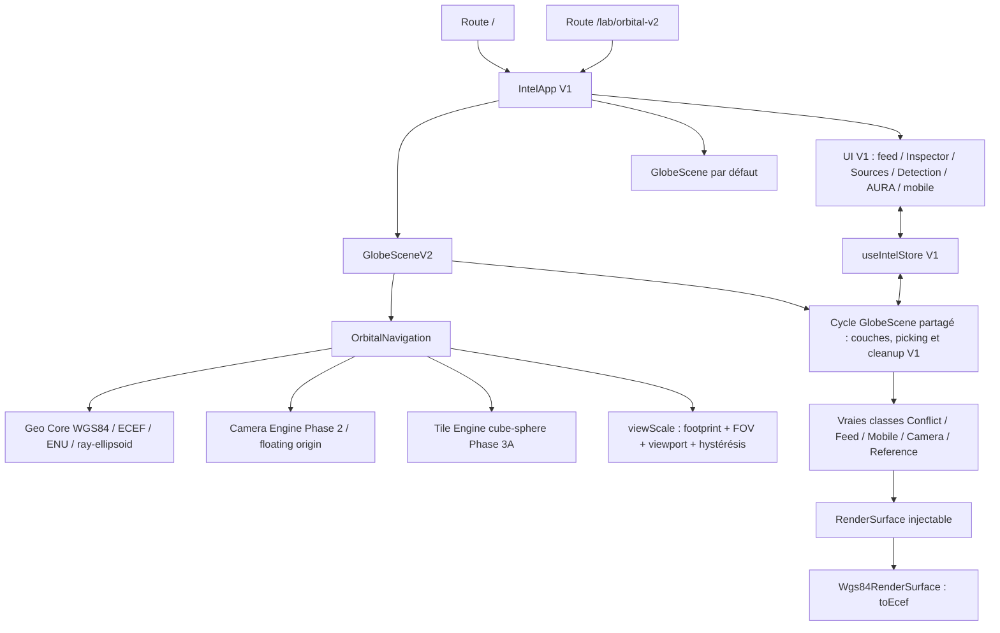

# ORBITAL V2 — contrat de parité V1

Base auditée : `origin/main = 58d701ab47059c83ec45ba642b2f3d81caa0215a`.
Branche d'intégration : `orbital-v2-integration`, créée depuis cette base exacte.
PR #17 enregistrée avant modification : OPEN / DRAFT, `a610f185b1a9297e4f9f4f886a984c5ef4b83310`, cinq jobs CI réussis. Elle n'est pas fusionnée ni utilisée comme base produit.

## Inventaire avant code

`IntelApp` possède déjà le shell desktop/mobile, les panneaux, le polling et SSE. `useIntelStore` est l'autorité de sélection unique et expose `focusRequest`; les UI ne connaissent pas la caméra. `GlobeScene` synchronise les vraies couches avec ce store, arbitre le picking et possède le cycle WebGL. L'intégration conservera ces trois contrats.

| Capacité | V1 réel | Cible V2 | Adaptation nécessaire | Risque | Test de non-régression |
|---|---|---|---|---|---|
| Shell / HUD | `IntelApp`, Header, Overlays | mêmes composants | injection de scène sur route dédiée | chargement SSR | comparer `/` et lab |
| État et sélection | `useIntelStore`, sélection unique | même instance/contrat | aucune logique métier recopiée | sélection concurrente | conflit/feed/caméra/pays exclusifs |
| Conflits | `ConflictLayer`, shaders/conflict | même classe / shader / intensité | projection, normales, origine | taille/occlusion | hover/clic/drag/détail sourcé |
| Feed globe | `FeedLayer` | même classe / couleurs / âge | projection et picking | face arrière | catégories, hover, clic |
| Feed panneau | `WorldFeedPanel`, `feedModel` | réutilisation directe | aucune | filtres perdus | périodes, nature, stale, caveats |
| Inspector | `Inspector`, `ClusterDetail`, `FeedItemDetail` | réutilisation directe | aucune | détail désynchronisé | sélection sur globe et dans fil |
| Sources | `SourcesPopover`, `/api/sources/status` | identique | aucune | indisponibilité masquée | error/stale/not_configured |
| Catégories | `FEED_CATEGORIES`, `FEED_SOURCES` | toutes les catégories du store | aucune | hardcoding | vérifier les 12 requêtes |
| Événements | `/api/events`, `/api/cluster`, filtres store | mêmes endpoints et filtres | aucune | faux incidents | MEDIA_SIGNAL, unités, provenance |
| Mobiles | `MobileLayer`, `vehicleModel` | mêmes silhouettes/caps/glide/trajets | projection arcs, normales et picking | point générique / cap faux | avion/navire/cargo + détail/track |
| Caméras | `CameraLayer`, `CameraDetail`, registre serveur | mêmes types média et catalogue opt-in | projection et agrégation existante | faux LIVE / chargement média global | clic caméra, détail, aucun média avant sélection |
| Référentiels | `ReferenceLayers`, `LayersMenu`, `layerModel` | mêmes centrales/bases/câbles/sanctions | projection points/arcs/coque | coutures / picking | activer, sélectionner, éteindre |
| Pays | `countryAt`, `CountrySearch`, `CountryPanel` | même index et fiche | ray/ellipsoid vers lat/lon | ancien repère sphérique | clic pays et recherche |
| Focus | `focusRequest` émis par store | Camera Engine V2 | un adaptateur central | UI couplée au moteur | feed/recherche/Detection/AURA |
| Detection | `DetectionPanel`, `useDetection`, serveur Detection | réutilisation directe | seulement focus | statuts ou preuves perdus | clic géolocalisable, stale/erreur |
| AURA | `AgentPanel`, `AuraCore`, API agent/voix | réutilisation directe | intentions store existantes | identité altérée | streaming/citations/contexte/voix explicite |
| Settings | `SettingsPanel`, Header, Escape | identique | aucune | accessibilité | ouvrir/fermer desktop/mobile |
| Mobile | `MobileSheet`, navigation, globeQuality | même shell | gestes caméra via GlobeGesture | tap après pinch/drag | 390×844, drag/pinch/tap/cancel |
| Rendu planète | `HolographicEarth`, OrbitLayer, Starfield | mêmes shaders/assets/paramètres | ellipsoïde WGS84, depth-only shell | disque noir / arrière visible | inspection visuelle mêmes vues |
| Coordonnées | sphère V1 | Geo Core WGS84/ECEF | projection de rendu injectable | datum/altitude inventés | coordonnées/normales/picking |
| Navigation | GlobeCamera V1 | Camera Engine Phase 2 | adaptateur de contrat | clipping/interruption | SPACE à DISTRICT, oblique, fly-to |
| Origine flottante | aucune dans V1 | Geo Core + Camera Engine | caméra et groupe atomiques | jitter/picking décalé | rebase et sélection |
| Tile/LOD | Phase 3A cube-sphere | calcul interne, debug absent du produit | sélection bornée | coût CPU | métriques, pas d'overlay par défaut |
| Échelle sémantique | presets de lab, pas de moteur produit dans main | dérivée caméra/footprint/FOV/viewport | petit adaptateur pur avec hystérésis | seuils instables | transitions et hystérésis |
| Réseau | SSE + polling `IntelApp`, caches serveur | identique | aucune nouvelle source | requêtes doublées | panne source, SSE backoff |
| Cleanup | GlobeScene + couches dispose | même ownership, runtime dispose | nouvelle caméra et tiles | fuite WebGL | navigation aller/retour |

## Sources réellement disponibles dans main

Les événements interrogent `REAL_DATASETS`: ACLED, GDELT, UCDP, FIRMS, imports CSV. La présence d'un connecteur ne prouve ni sa configuration ni des données récentes. Le store conserve les filtres et statuts existants.

`src/server/feeds/index.ts` regroupe 23 entrées, sans nouveau fournisseur :

| Catégorie | Providers V1 à conserver |
|---|---|
| disaster | GDACS, USGS, NASA EONET |
| health | OMS DON |
| space | Launch Library 2 |
| nuclear | World Nuclear News |
| un | UN News, UN Press |
| social | GDELT Events |
| economy | BCE/Frankfurter, Yahoo indices |
| uap | GEIPAN, AARO, NASA UAP |
| military | adsb.lol, AISStream military |
| weather | WMO, NWS, Environment Canada, NOAA NHC |
| infrastructure | IODA, IMF PortWatch |
| shipping | AISStream straits |

Le registre `cameraProviders` de `src/server/cameras/index.ts` contient exactement sept fournisseurs : Fintraffic, Singapore, NZTA, Hong Kong, DriveBC, Wisconsin et Nevada (les deux derniers via `IBI511_NETWORKS`). Les autres pistes mondiales mentionnées dans la documentation ne sont pas annoncées ici comme des adapters intégrés. Leurs credentials, caches, contrôles SSRF, proxy par identifiant, licences et statuts sont ceux de V1.

Les quatre référentiels effectifs sont centrales nucléaires et bases militaires (Wikidata), câbles sous-marins (TeleGeography), sanctions SDN (U.S. Treasury OFAC). Les API cameras/layers/detection/stream/agent et leurs registres/cache/licences restent ceux de V1. Aucun backend ni connecteur n'est remplacé. Les entrées non configurées ou indisponibles restent visibles dans les composants V1.

### État réel des sources pendant la revue

Instantané de `/api/sources/status` à **2026-11-02 11:16:32 UTC**, dans le serveur local utilisé pour les deux routes. Les routes partagent les mêmes API et registres; les statuts ne sont pas réinterprétés par V2. [Données de l'instantané](orbital-v2-review/source-health.json). `pending` signifie non interrogé dans ce contexte/cache, pas une source validée ni une absence de données. Les nombres sont datés, pas des valeurs codées dans le produit.

| Source/provider | Catégorie | V1 | V2 | Statut observé | Objets du statut |
|---|---|---|---|---|---:|
| `camera:drivebc` | road-camera | conservé | même registre/API | `pending` | 0 |
| `camera:fintraffic` | road-weather-camera | conservé | même registre/API | `pending` | 0 |
| `camera:hongkong` | road-camera | conservé | même registre/API | `pending` | 0 |
| `camera:nevada` | road-camera | conservé | même registre/API | `unconfigured` | 0 |
| `camera:nzta` | road-camera | conservé | même registre/API | `pending` | 0 |
| `camera:singapore` | road-camera | conservé | même registre/API | `pending` | 0 |
| `camera:wisconsin` | road-camera | conservé | même registre/API | `unconfigured` | 0 |
| `connector:acled` | conflicts | conservé | même registre/API | `unconfigured` | 0 |
| `connector:csv` | conflicts | conservé | même registre/API | `healthy` | 0 |
| `connector:firms` | conflicts | conservé | même registre/API | `unconfigured` | 0 |
| `connector:gdelt` | conflicts | conservé | même registre/API | `healthy` | 547 |
| `connector:ucdp` | conflicts | conservé | même registre/API | `healthy` | 16633 |
| `feed:aaro` | uap | conservé | même registre/API | `unavailable` | 0 |
| `feed:adsb-lol-military` | military | conservé | même registre/API | `stale` | 120 |
| `feed:aisstream-military` | military | conservé | même registre/API | `unconfigured` | 0 |
| `feed:aisstream-straits` | shipping | conservé | même registre/API | `unconfigured` | 0 |
| `feed:ecb-fx` | economy | conservé | même registre/API | `healthy` | 29 |
| `feed:environment-canada-alerts` | weather | conservé | même registre/API | `unavailable` | 0 |
| `feed:eonet` | disaster | conservé | même registre/API | `healthy` | 28 |
| `feed:gdacs` | disaster | conservé | même registre/API | `unavailable` | 0 |
| `feed:gdelt-events` | social | conservé | même registre/API | `healthy` | 93 |
| `feed:geipan` | uap | conservé | même registre/API | `healthy` | 54 |
| `feed:imf-portwatch` | infrastructure | conservé | même registre/API | `healthy` | 2 |
| `feed:ioda-outages` | infrastructure | conservé | même registre/API | `healthy` | 113 |
| `feed:ll2` | space | conservé | même registre/API | `healthy` | 30 |
| `feed:nasa-uap` | uap | conservé | même registre/API | `unconfigured` | 0 |
| `feed:noaa-nhc` | weather | conservé | même registre/API | `healthy` | 0 |
| `feed:nws-alerts` | weather | conservé | même registre/API | `healthy` | 93 |
| `feed:un-news` | un | conservé | même registre/API | `healthy` | 30 |
| `feed:un-press` | un | conservé | même registre/API | `healthy` | 10 |
| `feed:usgs` | disaster | conservé | même registre/API | `healthy` | 23 |
| `feed:who-don` | health | conservé | même registre/API | `healthy` | 30 |
| `feed:wmo-severe-weather` | weather | conservé | même registre/API | `healthy` | 1008 |
| `feed:wnn` | nuclear | conservé | même registre/API | `healthy` | 40 |
| `feed:yahoo-indices` | economy | conservé | même registre/API | `degraded` | 36 |
| `layer:military_bases` | reference | conservé | même registre/API | `healthy` | 2361 |
| `layer:nuclear_plants` | reference | conservé | même registre/API | `healthy` | 374 |
| `layer:sanctions` | reference | conservé | même registre/API | `healthy` | 145 |
| `layer:submarine_cables` | reference | conservé | même registre/API | `pending` | 0 |

Les états `unconfigured`, `unavailable`, `stale` et `degraded` sont volontairement conservés, avec leurs caveats et erreurs dans Sources. Les cinq catalogues de caméras sans clé sont `pending` ici parce que les caméras restent désactivées par défaut. Les clés facultatives Wisconsin/Nevada, ACLED, FIRMS et AISStream ne sont ni créées ni contournées.

## Architecture d'intégration retenue avant code

1. `IntelApp` reçoit une scène optionnelle, sa valeur par défaut restant `GlobeScene` V1.
2. `/lab/orbital-v2` injecte `GlobeSceneV2` dans le même `IntelApp`.
3. `GlobeSceneV2` fournit un runtime spatial au cycle de scène existant : caméra propriétaire, Geo Core, origine flottante, Tile Engine et échelle interne. Toute sélection continue à passer par le store.
4. Les vraies classes V1 reçoivent un contrat de projection optionnel. Le défaut appelle exactement la conversion sphérique historique. V2 projette les coordonnées sources via `toEcef` et adapte normales/shaders/picking à l'origine flottante.
5. Les offsets graphiques sont une politique de rendu sur ellipsoïde, jamais une altitude source résolue implicitement. Aucun `null`/MSL/AGL/UNKNOWN n'est promu en hauteur ellipsoïdale.
6. Aucun composant `ProductSignalLayer`, `ProductIntelPanel` ou mini-store de la PR #17 n'est importé. Les correctifs de profondeur/halo sont repris uniquement comme connaissances de rendu.

## Réalisation et adaptations

Le `GlobeScene` existant reste propriétaire de la synchronisation des couches, de la priorité de picking et du cycle WebGL. `GlobeSceneV2` l'utilise avec une factory stable `OrbitalNavigation`; aucune copie des effets de store ou de polling. L'interface `GlobeNavigation` expose les intentions de navigation déjà utilisées par la scène. Les panneaux continuent d'émettre `focusRequest` via le store.

Les fichiers Geo Core (`9c3dd83c`), Camera Engine (`43f458dd`) et Tile Engine (`f9a417d0`) sont déjà présents dans `main` et sont conservés sans modification. Aucun cherry-pick de PR #17 : ses corrections de halo (`3e66c37a`) et de coque depth-only (`bad71fca`) ont servi de référence technique. Les classes `Product*`, leur mini-feed et leur logique de chargement ne sont pas reprises.

`RenderSurface` est le seul point d'adaptation géométrique des vraies couches. Son défaut `SPHERE_SURFACE` appelle la fonction sphérique historique sans changer les shaders V1. V2 passe par `toEcef`; la permutation ECEF → Three est `(x, z, -y)`, avec une unité de rendu égale au demi-grand axe WGS84. Le Camera Engine reste entièrement en mètres et double précision. La caméra et le groupe terrestre sont déplacés ensemble avec l'origine flottante avant chaque rendu.

Les coordonnées des sources ne sont pas corrigées ou enrichies. La hauteur de rendu sur l'ellipsoïde est une convention graphique explicite : quelques mètres pour les points et lignes. Elle ne devient jamais une altitude source. Les arcs de câbles/trajets sont interpolés avec la primitive robuste de Phase 2, puis chaque échantillon est projeté via Geo Core; aucun Vincenty n'est invoqué. Les positions mobiles restent interpolées entre observations, sans extrapolation.

Les fragment shaders de conflit et de silhouette restent ceux de V1. Les adaptations de vertex shader concernent la projection, les normales WGS84 et les matrices après rebase. Le pas différentiel du heading est borné par la distance caméra en vue locale/oblique. Les billboards ne sont pas découpés par le depth buffer de la planète : la face cachée est rejetée explicitement. Les frontières, câbles et arcs utilisent la coque depth-only WGS84, distincte du corps visible translucide. Le halo avant et le remplissage profond conservent les correctifs visuels validés. Le far de rendu inclut le fond spatial V1; le Tile Engine continue d'utiliser le far géographique du Camera Engine.

L'audit a établi que V1 dessine tous les `EventType` avec la palette conflit. V2 conserve **tous** ces clusters dans `ConflictLayer`, mais passe une politique de teinte : palette rouge d'origine pour Battles / Explosions / Violence against civilians; palette Social pour Protests / Riots / Media signal; Catastrophes pour Thermal anomaly; Réseaux pour Strategic developments. Ni les records ni leur confiance/provenance ne changent. Le défaut V1 n'est pas modifié.

L'échelle interne `viewScale` n'existait pas en tant que module produit dans `main` : les noms SPACE à DISTRICT étaient des presets du lab. Le nouvel adaptateur dérive cette information du footprint, du FOV et du viewport avec une marge d'hystérésis de 18 %. Elle pilote le regroupement de la vraie `CameraLayer` (individus à CITY/DISTRICT/SENSOR), sans confondre cette densité visuelle avec la grille d'agrégation des événements. Les changements de cette dernière après zoom lissé sont reportés au store avec le debounce existant, jamais une requête par RAF. Aucun média n'est chargé à ce moment. Aucun bouton de presets ou overlay Tile/LOD n'est ajouté au produit. Le petit lien de comparaison « V1 ↗ » appartient uniquement à la route de validation.

En vue proche, les shaders interpolent le vecteur de vue avant sa normalisation par fragment : interpoler des vecteurs déjà normalisés produisait un faux rim cyan plein écran sur le maillage grossier. Le remplissage retourne progressivement vers la couleur océanique sombre V1 entre les vues régionales et locales. La vue planète conserve le remplissage et le halo validés; aucun faux détail urbain n'est dessiné.

Le contrat `GlobeGesture` V1 est conservé : priorité conflit → mobile/feed → caméra → référentiel → pays, seuil de déplacement de 5 px, suppression du tap après multitouch/cancel. La recherche, les détails et Detection commandent le nouveau moteur par `focusRequest`. AURA conserve exactement ses composants, protocole, citations, voix et contexte; **V1 n'émet actuellement pas de commande spatiale structurée depuis une réponse AURA**. Aucune nouvelle fonction agentique n'est inventée dans cette phase. Tout focus du store est pris en charge par l'adaptateur central.

## Validation et mesures

Les tests `tests/orbital-v2-spatial.test.ts` contrôlent projection V1 inchangée, projection Geo Core, picking des vraies classes après rebase et en vue locale, côté opposé, silhouettes/caps/trajets, caméra, focus/interruption, teintes non violentes et échelle/hystérésis. `tests/e2e/orbital-v2.spec.ts` ouvre réellement la route avec les fixtures de test existantes, jamais utilisées en production. Le parcours HLS/snapshot existant est également exécuté sur V1 et V2.

Mesures finales du 2 novembre 2026 (11:11–11:13 UTC), code du commit `577e4f3f`, Chromium desktop headless local, 1440×900 et viewport tactile 390×844, DPR 1, vraies données locales, deux routes parcourues successivement. Le comptage externe instrumente les draw calls WebGL et les frames réellement dessinées. Pas de mesure précise de temps GPU ni de mémoire GPU; le viewport mobile ne vaut pas un appareil mobile physique.

| Vue / scénario | V1 FPS | V2 FPS | V1 frame moyen | V2 frame moyen | Draw calls V1 / V2 | Heap JS V1 / V2 |
|---|---:|---:|---:|---:|---:|---:|
| Desktop immobile | 30,0 | 30,0 | 33,3 ms | 33,3 ms | 27,1 / 29,0 | 18,1 / 43,6 Mo |
| Desktop rotation | 30,0 | 30,0 | 33,3 ms | 33,3 ms | 28,1 / 27,9 | 22,1 / 43,4 Mo |
| Mobile immobile | 16,7 | 18,1 | 59,8 ms | 55,2 ms | 11 / 12 | 15,9 / 21,3 Mo |
| Mobile rotation | 17,5 | 17,4 | 57,1 ms | 57,5 ms | 11 / 12 | 17,6 / 37,1 Mo |

Résultats bruts et 13 captures : [galerie de comparaison](orbital-v2-review/README.md), [review.json](orbital-v2-review/review.json). Le heap est un instantané dépendant du GC, pas une mesure de fuite. Le p95 des frames est de 33,4 ms desktop et 66,7 ms mobile sur cette machine. Le débit desktop plafonne à environ 30 FPS dans cet environnement; aucun objectif 60 FPS n'est annoncé comme atteint. V2 a rendu environ 57 900 points et 150 400 triangles desktop / 48 500 points et 131 800 triangles mobile, sous les mêmes budgets de marqueurs V1. Les points comptent les assets visuels, pas autant d'événements. Le coût d'update des couches par frame observé est de 0,23–0,37 ms; la sélection Tile/LOD de 1,4–2,7 ms, bornée à 5 Hz pendant un mouvement et ignorée à vue stable. Le budget de 128 tuiles peut être saturé à l'échelle planète : il est explicite, sans prétendre avoir atteint le SSE cible partout. Les images/vidéos de caméra ne sont pas chargées avant sélection.

Validation sur ce code : `pnpm typecheck` réussi; `pnpm test` : **734 tests réussis, 88 tests déjà ignorés**, sans désactivation; `pnpm build` réussi; `pnpm audit` code 0 (un avis modéré ignoré par la politique existante, aucune dépendance modifiée); **64/64 tests Playwright réussis**, suite complète Chromium sur le build de production local; `git diff --check` réussi. Le First Load JS de `/` reste à 104 kB, celui de la nouvelle route à 107 kB. Node local 26.13 est hors matrice supportée : la CI Node 22/24 et PostgreSQL réel est un contrôle distinct obligatoire. Les tests de caméra HLS sont des fixtures : ils ne certifient pas un flux Wisconsin/Nevada réel sans clé. La première CI a détecté une course dans le test de clic conflit après reload : il attendait la télémétrie caméra, pas le chargement de la couche. Le test attend désormais le hover effectif avant de cliquer et retarde volontairement la réponse événement pour couvrir ce cas; aucune logique produit n’a été changée pour contourner cet échec.

Les vrais référentiels ont retourné notamment 374 centrales et 713 câbles lors du contrôle local, sans erreur WebGL. Les bases et sanctions ont nécessité un remplissage de cache plus long (dizaines de secondes) : les mêmes états loading/stale/error V1 restent affichés. Ces nombres sont une observation datée, pas des constantes.

## Limites héritées et gate

- Natural Earth 110m et le masque terrestre V1 restent les seules données de surface : pas de rues, bâtiments, relief ou image satellite. Le zoom profond démontre la navigation; il ne prouve pas une carte urbaine détaillée.
- Les buffers de couches V1 restent en Float32 normalisés. La précision géodésique canonique du Geo Core n'est pas une promesse de précision GPU au centimètre. Le futur Map Data Engine devra utiliser des buffers locaux/tuilés avant de certifier STREET/SENSOR.
- Le catalogue caméra mondial reste opt-in, paginé comme V1 et borné à 10 000 métadonnées côté store. Son chargement par viewport reste une dette connue de V1, sans téléchargement massif de médias. Les providers à clé absente restent non configurés; aucune vidéo réelle de ces providers n'est annoncée comme validée sans clé.
- AARO peut refuser l'accès automatisé; NASA UAP n'a pas de flux daté; ACLED/FIRMS/AISStream dépendent de la configuration existante. Aucun trou n'est rempli avec des données fictives.
- `OrbitLayer` est le décor orbital V1, pas un nouveau catalogue ni un suivi réel de satellites.
- Les mesures mobile sont des viewports Chromium. Safari, tactile matériel et mémoire GPU ne sont pas certifiés par ce contrôle.

Le gate technique et les captures doivent être relus humainement avant la suite. Une régression restante interdit de déclarer la phase terminée. Aucun Terrain/Map Data Engine, nouveau fournisseur, déploiement ou remplacement de `/` n'est inclus.
