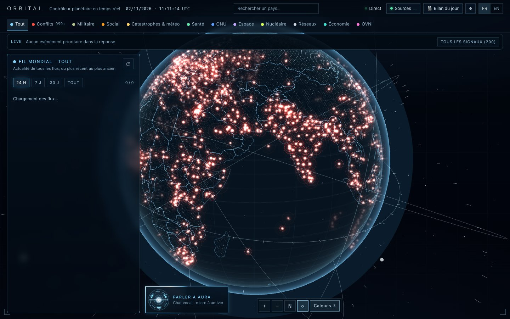
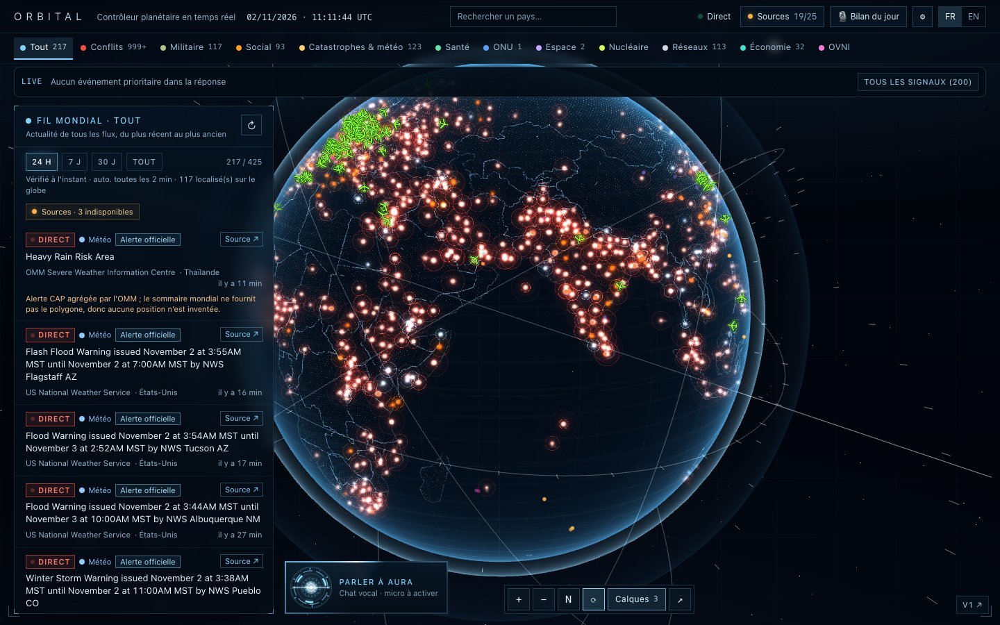
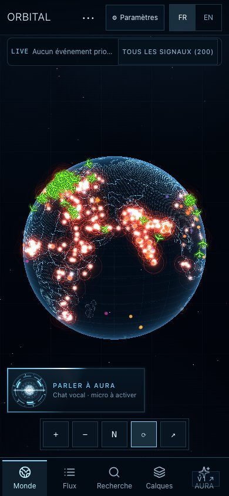

# Revue locale ORBITAL V1 / V2

Captures Chromium réelles, 2 novembre 2026, code `577e4f3f` (les commits suivants ne changent que documentation/preuves). Vraies API du dépôt, aucune fixture injectée dans ces captures. Les pages sont ouvertes successivement : données et caches peuvent évoluer entre V1 et V2; la capture planète V1 montre notamment son état de chargement initial du feed. Les tests automatisés utilisent séparément leurs fixtures reproductibles.

## Ouvrir le prototype

```bash
pnpm dev --port 3011
```

- V1 : http://localhost:3011/
- V2 : http://localhost:3011/lab/orbital-v2
- Même UI, recherche, feed, Inspector, Sources, Detection, AURA et navigation mobile. Le lien discret « V1 ↗ » revient à la référence.
- Rotation : drag; zoom : molette ou boutons; zoom continu fin : Ctrl + molette; pan : clic droit + drag; oblique : bouton ↗; north-up : N; reset : ↻. Mobile : drag/pinch et barre de navigation V1.
- Pour les vues Europe/France, rechercher France puis zoomer. Le niveau interne découle de la caméra, sans boutons de presets de lab dans le produit.

## Comparaison desktop 1440×900

| Vue | V1 | V2 |
|---|---|---|
| Planète | [V1](v1-1440-planet.jpg) | [V2](v2-1440-planet.jpg) |
| Espace | [V1](v1-space.jpg) | [V2](v2-space.jpg) |
| Europe | [V1](v1-europe.jpg) | [V2](v2-europe.jpg) |
| France | [V1](v1-france.jpg) | [V2](v2-france.jpg) |




## Zoom profond V2

[City](v2-city-scale.jpg) · [District](v2-district-scale.jpg) · [District oblique](v2-oblique-district.jpg)

Ces vues prouvent la navigation et le maintien du shell. Natural Earth 110m et le masque terrestre V1 n'apportent pas de rues, bâtiments ou terrain : une zone intérieure peut donc rester sombre. Ce n'est pas une cartographie urbaine achevée.

## Mobile 390×844

[V1](v1-390-planet.jpg) · [V2](v2-390-planet.jpg)



## Reproduire les preuves

Serveur local lancé, dans un deuxième terminal :

```bash
PLAYWRIGHT_CHANNEL=chrome node scripts/review-orbital-v2.mjs
```

Par défaut : `/tmp/orbital-v2-review`. Variables optionnelles : `ORBITAL_LAB_URL`, `ORBITAL_REVIEW_OUTPUT`; retirer `PLAYWRIGHT_CHANNEL` pour le Chromium Playwright installé. Le script ne fabrique aucune donnée source; les requêtes utilisent les mécanismes d'ingestion/cache habituels du serveur local.

[Mesures brutes et télémétrie des vues](review.json) · [Instantané de santé des sources](source-health.json) · [Matrice, architecture et limites](../orbital-v2-parity.md)

Les FPS comptent les frames réellement dessinées, les draw calls sont instrumentés WebGL. La mémoire JS dépend du GC. Aucune mesure GPU précise; viewport mobile, pas appareil physique. Aucune erreur critique JS/WebGL/hydratation/CSP observée pendant le parcours. Ces preuves ne remplacent pas la validation visuelle humaine.
